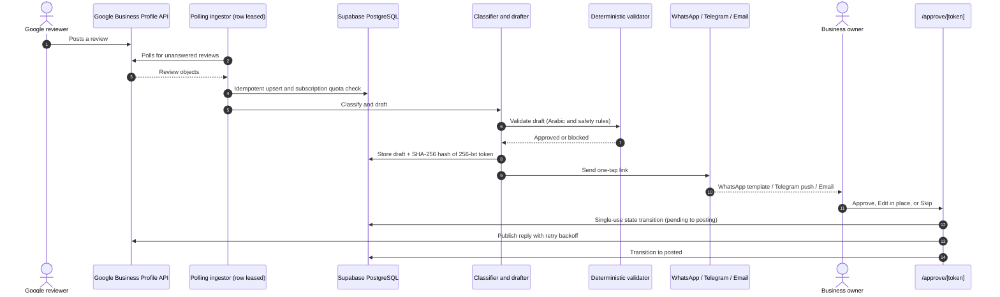
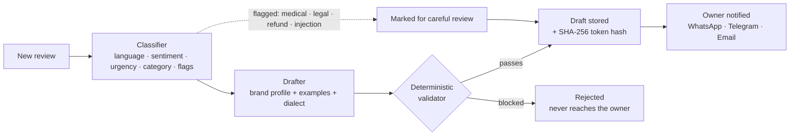
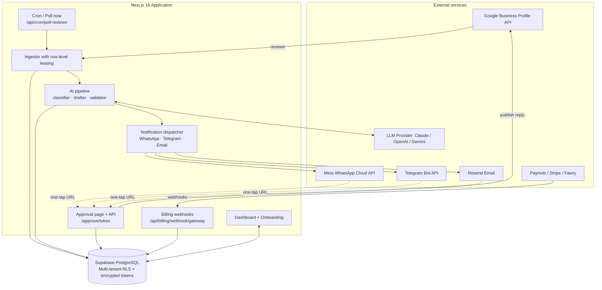
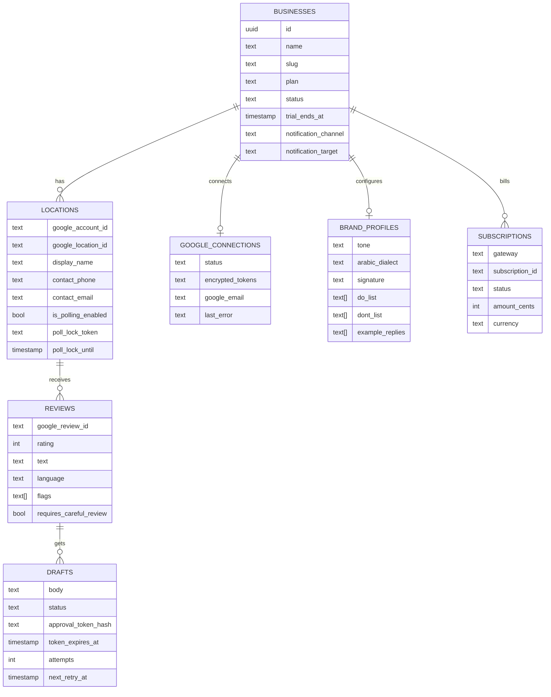
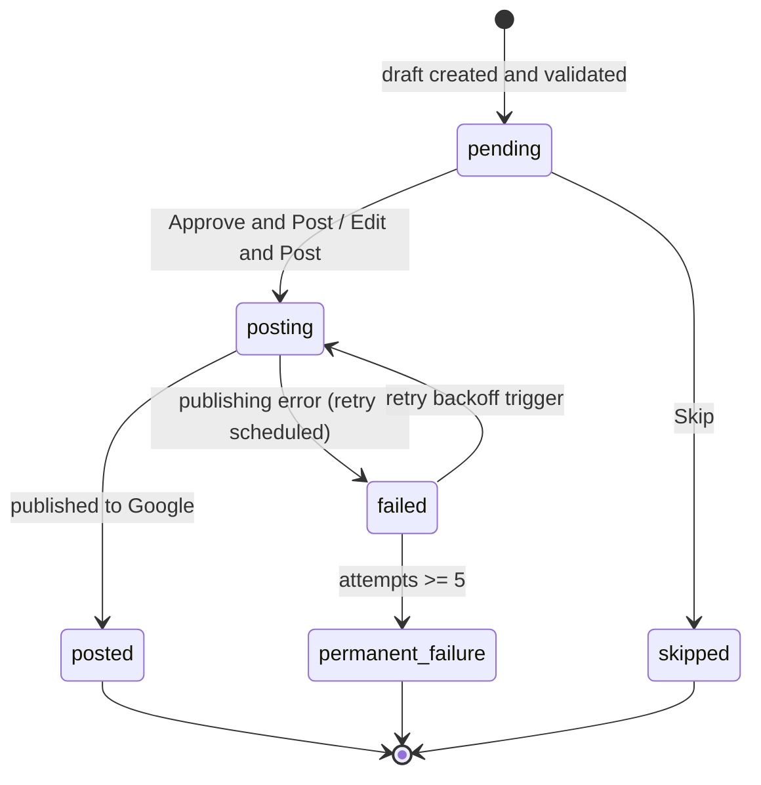

<p align="center">
  
</p>

<p align="center">
  
  
  
  
  
  
  
</p>

# Radd (رد)

**AI-drafted replies to every Google review, approved by the owner in one tap.**

Radd is a multi-tenant SaaS for local businesses (cafés, restaurants, clinics, retail) in Egypt and the wider MENA region. It watches a business's Google Business Profile for new reviews, classifies them, drafts a reply in the brand's voice (including natural **Egyptian Arabic**), checks that draft against deterministic safety rules, and sends the owner a one-tap approval link by **WhatsApp**, **Telegram**, or **email**. When the owner approves or edits the reply, Radd publishes it to Google.

> **Status:** feature-complete backend with multi-gateway billing (Paymob in EGP, Stripe, Fawry), a WhatsApp Cloud API approval channel, multi-location management, Row Level Security (RLS), and a Google Business Profile integration. It is tested end to end against built-in simulators; live Google and WhatsApp access depend on each provider's approval process. The web UI redesign is in progress (see [UI preview](#ui-preview) and [Limitations](#limitations)).

<p align="center">
  
  <br>
  <sub>Illustration of the three steps: ingestion and drafting, one-tap owner approval, and publishing to Google.</sub>
</p>

---

## Table of contents

- [Why Radd](#why-radd)
- [How it works](#how-it-works)
- [UI preview](#ui-preview)
- [Example behavior](#example-behavior)
- [Features](#features)
- [Brand voice](#brand-voice)
- [Subscriptions and billing](#subscriptions-and-billing)
- [Tech stack](#tech-stack)
- [Architecture](#architecture)
- [Safety and security](#safety-and-security)
- [Getting started](#getting-started)
- [Configuration](#configuration)
- [WhatsApp template setup](#whatsapp-template-setup)
- [Deployment](#deployment)
- [Routes and endpoints](#routes-and-endpoints)
- [Verification and evaluation](#verification-and-evaluation)
- [Project structure](#project-structure)
- [Data model](#data-model)
- [Draft lifecycle](#draft-lifecycle)
- [FAQ](#faq)
- [Limitations](#limitations)
- [Brand assets](#brand-assets)
- [Notes on Google branding](#notes-on-google-branding)
- [Author](#author)
- [License](#license)

---

## Why Radd

Replying to reviews improves how a business looks on Google, but owners rarely have time to write replies, and generic AI tools tend to sound robotic, mishandle dialect, or promise things the business never offered.

Radd focuses on four fundamentals:

1. **Local language quality:** replies in authentic Egyptian Arabic (عامية مصرية), Modern Standard Arabic, English, or a natural mix matching the reviewer's tone.
2. **A human always decides:** nothing is posted without the owner's explicit approval, and sensitive complaints are flagged with visual badges.
3. **Safety by construction:** a deterministic validator sits *after* the model, blocking refund promises, fake discounts and contact leaks regardless of what the LLM produces.
4. **Frictionless one-tap approval:** messages arrive on **WhatsApp**, **Telegram** or email with a direct button that opens a mobile-first page requiring no login.

---

## How it works



### The AI pipeline



---

## UI preview

> **Design preview.** The images below are mockups of the planned interface, not captures of the running app. The UI redesign is in progress, and real screenshots will replace them.

### Owner dashboard (design preview)

Planned layout: answer rate, approval metrics, active notification channel, and a review and draft timeline.

<p align="center">
  
</p>

### Mobile one-tap approval page (design preview)

Planned mobile page opened from WhatsApp, Telegram or email: the review, the suggested reply, and the approval actions.

<p align="center">
  
  <br>
  <sub>Mockup of a 5★ Egyptian Arabic review with a suggested reply and action buttons.</sub>
</p>

---

## Example behavior

Illustrative examples of how different reviews are handled:

| Review | What Radd does |
| :--- | :--- |
| Positive review in Egyptian Arabic | Detects `ar`, drafts a warm reply in natural dialect using brand tone and signature |
| English review with a mixed complaint | Detects the language, acknowledges the issue, invites the customer to call the official number. No promises or compensation |
| Review containing instructions such as "ignore all previous instructions" | Treated as untrusted data, flagged `injection_suspected`, marked for careful review |
| Star-only review with no text | Drafts a short thank-you without inventing details of the visit |
| Review demanding a refund or mentioning legal action | Flagged `refund` or `legal`, requires careful owner review, and the validator blocks any compensation promise |
| Review mentioning an allergy or illness | Flagged `medical`, marked for careful review, no medical claims in the reply |

---

## Features

**Review handling and ingestion**
- Polls Google Business Profile for unanswered reviews with a protected cron endpoint and a manual **Poll now** button.
- Idempotent ingestion keyed on the Google review ID, preventing duplicate processing.
- Row-level polling leases (`poll_lock_token`, `poll_lock_until`) prevent duplicate processing when cron runs overlap.
- Skips reviews that already have an owner reply.

**AI classification and drafting**
- Detects language: Egyptian Arabic, Modern Standard Arabic, English, mixed, or star-only (empty text).
- Detects sentiment, urgency, and category (food, service, ambiance, delivery, billing).
- Flags sensitive cases: `medical`, `legal`, `refund`, and `injection_suspected`. Negative or flagged reviews trigger visual warning badges.
- Drafts replies using the brand profile: tone, dialect, signature, do/don't lists, and reference examples.
- Handles star-only reviews without inventing customer interactions.

**WhatsApp approval channel (Meta Cloud API)**
- Official Meta WhatsApp Business Cloud API integration using a message template (`review_reply_approval`) with a dynamic URL button that opens `/approve/[token]`. See [WhatsApp template setup](#whatsapp-template-setup).
- Automatic international phone number normalization (for example `01001234567` → `201001234567`).
- Zero-credential local console mocking for offline testing and CI.
- Disconnection alerts sent through the owner's channel if Google OAuth credentials expire or are revoked.

**Owner experience and one-tap approval**
- **Mobile-first approval page**, login-free, secured by a signed single-use 256-bit token.
- Three actions: **Approve and Post**, **Edit and Post** (inline, with character-length checks), and **Skip**.
- Link expiry (72-hour lifetime) with one-tap secure renewal (`/api/drafts/[token]/renew`), redispatched only to the owner's registered channel.
- Notification channels: **WhatsApp**, **Telegram** (inline button) and **email** (Resend).

**Multi-location management**
- Multi-branch businesses under a single account, each branch mapped to its own Google location ID.
- Branch-specific contact details (phone, care email) and signature overrides.
- Dashboard location switcher with branch-filtered timelines and analytics.
- Per-location polling leases, so concurrent runs never process the same branch twice.

**Publishing state machine**
- Resilient transitions: `pending` → `posting` → `posted` or `failed`.
- Exponential backoff retries with scheduling (`next_retry_at`) and an attempts counter.
- Atomic claiming ensures only one worker publishes a given draft at a time.

**Google OAuth lifecycle and data deletion**
- Automatic revocation detection (`invalid_grant`, HTTP 401/403) with an immediate polling pause.
- Reconnection notices across WhatsApp, Telegram and email with a direct reconnect link.
- Two disconnection modes:
  - **Soft disconnect:** disables sync and revokes OAuth tokens while keeping historical review data.
  - **Full deletion:** purges stored drafts, reviews, location records and credentials from Supabase on request.

---

## Brand voice

Each business configures how Radd speaks during onboarding. The drafter uses these settings for every reply:

| Setting | What it controls |
| :--- | :--- |
| Tone | Overall voice, for example warm, formal, energetic, or playful |
| Dialect | Egyptian Arabic (عامية مصرية, primary and evaluated) or Modern Standard Arabic. Gulf and Levantine options exist but are not yet evaluated |
| Signature | The sign-off appended to replies (for example `فريق Roastery & Co.`) |
| DO list | Things replies should do or mention (for example welcome back, mention specialties) |
| DON'T list | Things replies must never say (for example never offer free drinks, never admit fault) |
| Example replies | Past replies the owner likes, used as few-shot style references |
| Official contact number | The only phone number a reply is allowed to include |

---

## Subscriptions and billing

Radd includes a billing engine designed for regional payment options alongside international cards.

| Plan | Launch pricing | Monthly reviews | Locations | Channels |
| :--- | :--- | :-: | :-: | :--- |
| **Starter** | 499 EGP / month | Up to 100 | 1 location | WhatsApp, Telegram, Email |
| **Pro** | 999 EGP / month | Up to 500 | Up to 3 locations | WhatsApp, Telegram, Email |
| **Enterprise** | Custom | Custom limits | Custom | Custom onboarding |

*Prices are launch pricing and may change.*

**Supported payment gateways**
1. **Paymob (Egypt):** cards (Visa, Mastercard, Meeza) and mobile wallets, with HMAC-SHA512 webhook signature verification.
2. **Stripe (global):** subscription checkout sessions with webhook signature validation.
3. **Fawry (Egypt):** reference-number checkout for cash and kiosk payments.

**Entitlement enforcement**
- Checks the business plan and subscription status (`active` or a valid `trial_ends_at`) before review ingestion and AI drafting.
- Stops new drafts when a quota or subscription limit is reached, while keeping historical dashboard data accessible.

---

## Tech stack

| Layer | Technology |
| :--- | :--- |
| Framework | Next.js 16 (App Router, Turbopack), React 19, TypeScript (strict mode) |
| Styling | Tailwind CSS |
| Database and auth | Supabase (PostgreSQL 15), `@supabase/supabase-js`, Row Level Security (RLS) |
| Server security | `server-only` isolation, Node.js `crypto` (AES-256-GCM token encryption, SHA-256 hashes) |
| AI layer | Pluggable LLM layer (Anthropic Claude, OpenAI, Google Gemini) with structured JSON output and a local simulator fallback |
| Google | Business Profile APIs through `googleapis`, OAuth 2.0 with offline refresh tokens |
| Notifications | Meta WhatsApp Business Cloud API, Resend (email), Telegram Bot API |
| Billing and payments | Paymob (EGP, HMAC-SHA512), Stripe Checkout and webhooks, Fawry |
| Validation | Zod schema validation for API inputs and webhooks |
| Testing | Node.js native test runner (`node:test`), `tsx` |

---

## Architecture



---

## Safety and security

1. **Prompt-injection defense.** Review text is wrapped in isolated data tags (`<untrusted_review_data>`) and treated strictly as content, never instructions. Suspicious prompts are flagged `injection_suspected`.
2. **Deterministic output validator.** Pure TypeScript checks run on every generated reply before the owner sees it:
   - blocks refund and compensation promises (Arabic and English phrasing),
   - blocks unauthorized discounts, promo codes and vouchers,
   - strips phone numbers other than the location's official contact number,
   - flags Arabic WhatsApp invitation phrases (for example `كلمنا واتساب`, `تواصل معنا على الواتس`),
   - enforces length bounds (10 to 1,000 characters).
3. **Single-use magic links with hashed tokens.** Approval tokens are 256-bit random secrets. Only the SHA-256 hash is stored, so a database leak cannot expose usable approval links.
4. **Token encryption at rest.** OAuth access and refresh tokens are encrypted with AES-256-GCM (`TOKEN_ENCRYPTION_KEY`).
5. **Log scrubbing.** Tokens, keys and authorization strings are recursively redacted from server logs.
6. **Multi-tenant Row Level Security.** Supabase tables enforce tenant boundaries scoped by `business_id`.
7. **Human in the loop.** The model never auto-publishes. Every reply requires explicit owner approval.

---

## Getting started

### Prerequisites

- Node.js 20+
- A Supabase project (or local Supabase)
- Optional for live use: Google Cloud OAuth credentials, Meta WhatsApp Cloud API credentials, a Resend API key, a Telegram bot token, and Paymob / Stripe / Fawry keys.

*Without external keys, Radd runs in offline mock mode with built-in Google, WhatsApp, Telegram, email, billing and LLM simulators.*

### Install

```bash
git clone https://github.com/mo74x/radd.git
cd radd
npm install
```

### Set up the database

Apply the Supabase migrations in order from `supabase/migrations/`:

- `0001_init.sql`
- `0002_rls_policies.sql`
- `0003_token_expiry_renewal.sql`
- `0004_publishing_state_machine.sql`
- `0005_location_overrides.sql`
- `0006_billing_subscriptions.sql`

### Configure environment

Copy `.env.example` to `.env` and fill in your keys (see [Configuration](#configuration)):

```bash
cp .env.example .env
```

### Run locally

```bash
npm run dev
```

- Dashboard: <http://localhost:3000/dashboard>
- Onboarding and settings: <http://localhost:3000/onboarding>

---

## Configuration

| Variable | Required | Purpose |
| :--- | :-: | :--- |
| `NEXT_PUBLIC_SUPABASE_URL` | Yes | Supabase project URL |
| `NEXT_PUBLIC_SUPABASE_ANON_KEY` | Yes | Supabase client public key |
| `SUPABASE_SERVICE_ROLE_KEY` | Yes | Supabase admin key (server only, never expose) |
| `TOKEN_ENCRYPTION_KEY` | Yes | 32-byte hex secret for AES-256-GCM token encryption |
| `CRON_SECRET` | Yes | Bearer token protecting `/api/cron/poll-reviews` |
| `NEXT_PUBLIC_APP_URL` | Yes | Base app URL (for example `https://radd.app`), used to build `/approve/[token]` links |
| `GOOGLE_CLIENT_ID` / `GOOGLE_CLIENT_SECRET` | No (mock fallback) | Google Cloud OAuth credentials |
| `META_WHATSAPP_TOKEN` | No (mock fallback) | Meta WhatsApp Business system user token |
| `WHATSAPP_PHONE_NUMBER_ID` | No (mock fallback) | WhatsApp Business phone number ID |
| `WHATSAPP_TEMPLATE_NAME` | No | Template name (default: `review_reply_approval`) |
| `WHATSAPP_TEMPLATE_LANG` | No | Template language code (default: `ar`) |
| `TELEGRAM_BOT_TOKEN` | No (mock fallback) | Telegram bot token from @BotFather |
| `RESEND_API_KEY` | No (mock fallback) | Resend API key for transactional email |
| `PAYMOB_API_KEY` / `PAYMOB_HMAC_SECRET` | No (mock fallback) | Paymob gateway credentials |
| `STRIPE_SECRET_KEY` / `STRIPE_WEBHOOK_SECRET` | No (mock fallback) | Stripe payments and webhook validation |
| `FAWRY_MERCHANT_CODE` / `FAWRY_SECRET_KEY` | No (mock fallback) | Fawry payment gateway |
| `ANTHROPIC_API_KEY` / `OPENAI_API_KEY` | No (simulator fallback) | AI model provider keys |

### Scheduling the review poller

Call the cron endpoint on a schedule (Vercel Cron, GitHub Actions, or Supabase `pg_cron`):

```bash
curl -H "Authorization: Bearer $CRON_SECRET" https://your-domain.com/api/cron/poll-reviews
```

---

## WhatsApp template setup

The WhatsApp channel sends a message template with a dynamic URL button. Create it in Meta Business Manager (WhatsApp Manager, Message templates) before enabling the channel:

1. **Name and language:** use the values of `WHATSAPP_TEMPLATE_NAME` (default `review_reply_approval`) and `WHATSAPP_TEMPLATE_LANG` (default `ar`). They must match exactly.
2. **Body:** short text announcing a new review, with variables for the values your dispatcher sends. Check `src/lib/notifications/` for the exact parameters and their order, and keep the template in sync with it.
3. **Button:** add a **URL** button of the dynamic type, with a base URL ending in `/approve/{{1}}` on your `NEXT_PUBLIC_APP_URL` domain. The dispatcher fills `{{1}}` with the approval token.
4. **Submit for review.** Meta reviews templates and decides their category, and approval can take time. Until it is approved, test with the built-in console mock.
5. **Credentials:** create a system user token with WhatsApp messaging permission, and set `META_WHATSAPP_TOKEN` and `WHATSAPP_PHONE_NUMBER_ID`.

Meta periodically retires old Graph API versions, so check that the API version used in the code is still supported.

---

## Deployment

A typical setup uses Vercel for the app and Supabase for the database.

1. **Supabase:** create a project and apply the six migrations in order (see [Set up the database](#set-up-the-database)).
2. **Environment:** add the variables from [Configuration](#configuration) to your hosting provider. Keep `SUPABASE_SERVICE_ROLE_KEY` and `TOKEN_ENCRYPTION_KEY` server-only.
3. **Google OAuth:** register your production redirect URI for `/api/google/oauth/callback` in Google Cloud and add the required consent-screen details.
4. **Cron:** schedule `/api/cron/poll-reviews` every few minutes. Vercel Cron sends `Authorization: Bearer <CRON_SECRET>` automatically when `CRON_SECRET` is set.
5. **Billing webhooks:** point each gateway at `/api/billing/webhook/<gateway>` (Paymob, Stripe, Fawry) and set the matching signing secrets.
6. **Notifications:** configure the Telegram bot, Resend domain, and the WhatsApp template.
7. **Smoke test:** run the verification scripts and approve one real or simulated review end to end.

---

## Routes and endpoints

| Route | Type | Purpose |
| :--- | :--- | :--- |
| `/dashboard` | Page | Analytics, location selector, review timeline, and manual **Poll now** button |
| `/onboarding` | Page | 3-step setup: connect Google, configure dialect and brand voice, select notification channel |
| `/approve/[token]` | Page | One-tap approval page (no login, mobile-first, 256-bit token secured) |
| `/api/google/oauth/connect` | API | Starts the Google OAuth consent flow |
| `/api/google/oauth/callback` | API | Handles the code exchange and encrypted token storage |
| `/api/google/disconnect` | API | Soft disconnect or full data deletion |
| `/api/cron/poll-reviews` | API | Scheduled review poller with row-level lease locking (`CRON_SECRET`) |
| `/api/drafts/[token]` | API | Single-use decision: approve, edit, or skip |
| `/api/drafts/[token]/renew` | API | Token renewal with rate limiting, redispatched to the owner's channel |
| `/api/billing/webhook/[gateway]` | API | Webhook receiver for Paymob (HMAC-SHA512), Stripe and Fawry |
| `/api/dashboard/settings` | API | Zod-validated updates for brand profile, location overrides and alert channels |

---

## Verification and evaluation

Radd includes a native test suite plus prompt and real-review evaluation runners:

```bash
# Unit and integration tests
npm test

# Prompt evaluation suite (30 synthetic cases)
npm run eval:prompts

# Real-review evaluation suite (72 Egyptian reviews)
npm run eval:real

# Multi-tenant RLS isolation and token encryption verification
npx tsx --env-file=.env scripts/verify-rls.ts
```

### Evaluation suites (102 cases)

| Suite | Cases | Focus | Result |
| :--- | :-: | :--- | :-: |
| **Prompt evaluation** (`eval-prompts.ts`) | 30 | Dialect fidelity, star-only handling, injection defense, compensation-trap blocking | 30 / 30 |
| **Real Egyptian reviews** (`eval-real-reviews.ts`) | 72 | Café, restaurant and clinic reviews in Egyptian dialect, tourist complaints, mixed English | 72 / 72 |
| **Test suites** (`tests/*.test.ts`) | n/a | Paymob HMAC, Stripe webhooks, WhatsApp templates, Arabic normalization, RLS policies | All passing |

> The prompts and validator were iterated against these cases, so treat the pass rates as regression checks, not as an unbiased accuracy measurement. The reviews have names and contact details removed.

---

## Project structure

```text
radd/
├── docs/                        # UI previews, banner, icon, and flow diagrams
├── scripts/                     # eval runners + RLS verification script
├── src/
│   ├── app/
│   │   ├── api/
│   │   │   ├── billing/webhook/[gateway]/  # Paymob, Stripe, Fawry webhooks
│   │   │   ├── cron/poll-reviews/          # scheduled polling endpoint
│   │   │   ├── dashboard/settings/         # settings API (Zod-validated)
│   │   │   ├── drafts/[token]/             # single-use approval and renewal
│   │   │   └── google/oauth/               # OAuth connect, callback, disconnect
│   │   ├── approve/[token]/                # mobile one-tap approval UI
│   │   ├── dashboard/                      # analytics + review timeline
│   │   └── onboarding/                     # 3-step setup and brand voice
│   ├── lib/
│   │   ├── ai/                             # classifier, drafter, validator, pipeline, prompts
│   │   ├── approvals/                      # approval state machine and token renewal
│   │   ├── billing/                        # Paymob, Stripe, Fawry gateways and entitlements
│   │   ├── crypto/                         # AES-256 encryption, hashing, log scrubber
│   │   ├── google/                         # client (real + mock), ingestor, lifecycle
│   │   ├── notifications/                  # WhatsApp, Telegram, Resend dispatcher
│   │   └── supabase/                       # admin client and RLS configuration
│   └── types/database.ts
└── supabase/migrations/                    # 0001 through 0006 migrations
```

---

## Data model



---

## Draft lifecycle



---

## FAQ

**Does Radd post replies automatically?**
No. Every reply requires explicit owner approval through the one-tap approval page.

**How does WhatsApp approval work?**
Radd sends a WhatsApp message template with a dynamic URL button. Tapping it opens `/approve/[token]`, where the owner can approve with one tap, edit the draft inline, or skip.

**Can Radd run without external API keys?**
Yes. Built-in mock implementations cover Google Business Profile, WhatsApp, Telegram, email, billing and LLM generation, so the whole flow can be tested locally and offline.

**Which Arabic dialects are supported?**
Egyptian Arabic and Modern Standard Arabic are the evaluated options. Gulf and Levantine dialects can be selected but have not been evaluated yet.

**Which payment gateways are supported?**
Paymob (cards and mobile wallets in EGP), Stripe for international cards, and Fawry reference codes.

**What happens if an approval link expires?**
Links expire after 72 hours. An owner opening an expired link can request a fresh one with one tap, and it is sent only to their registered WhatsApp, Telegram or email.

---

## Limitations

- **UI:** the web interface is being redesigned. The images in [UI preview](#ui-preview) are design mockups, not screenshots.
- **Provider approvals:** live Google Business Profile access requires Google's API access and OAuth verification, and WhatsApp templates require Meta's review. Until then, use the built-in simulators.
- **Evaluation:** the evaluation suites were authored and iterated by the project author. They guard against regressions but are not an independent accuracy benchmark.
- **Legal and pricing:** this README is not legal advice. Privacy, data-deletion and tax obligations, and the launch pricing, should be reviewed before onboarding paying customers.

---

## Brand assets

| Asset | Description | File |
| :--- | :--- | :--- |
| **Banner** | GitHub project banner | [`docs/radd-github-banner.svg`](docs/radd-github-banner.svg) |
| **Flow diagram** | 3-step flow illustration | [`docs/radd-flow.svg`](docs/radd-flow.svg) |
| **Dashboard preview** | Desktop dashboard design mockup | [`docs/radd-preview-dashboard.svg`](docs/radd-preview-dashboard.svg) |
| **Approval preview** | Mobile approval page design mockup | [`docs/radd-preview-approval.svg`](docs/radd-preview-approval.svg) |
| **App icon** | Radd brand mark | [`docs/radd-icon.svg`](docs/radd-icon.svg) |

<p align="center">
  
</p>

---

## Notes on Google branding

Radd is an independent product. It is not affiliated with, endorsed by, or sponsored by Google. "Google" and "Google Business Profile" are trademarks of Google LLC and are used here solely to describe compatibility.

---

## Author

**Mohamed Arafa Shabaan**: Backend and systems integration engineer.
[GitHub](https://github.com/mo74x) · [LinkedIn](https://www.linkedin.com/in/mohamed-arafa-6628211b8/)

---

## License

This project is licensed under the [MIT License](LICENSE) © 2026 Mohamed Arafa Shabaan. See the [`LICENSE`](LICENSE) file for the full text.