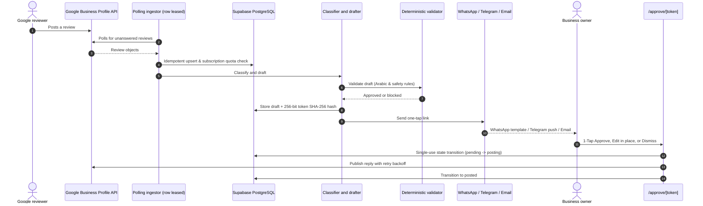
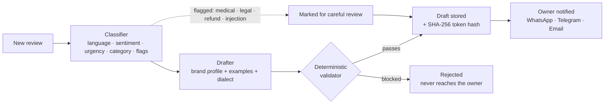
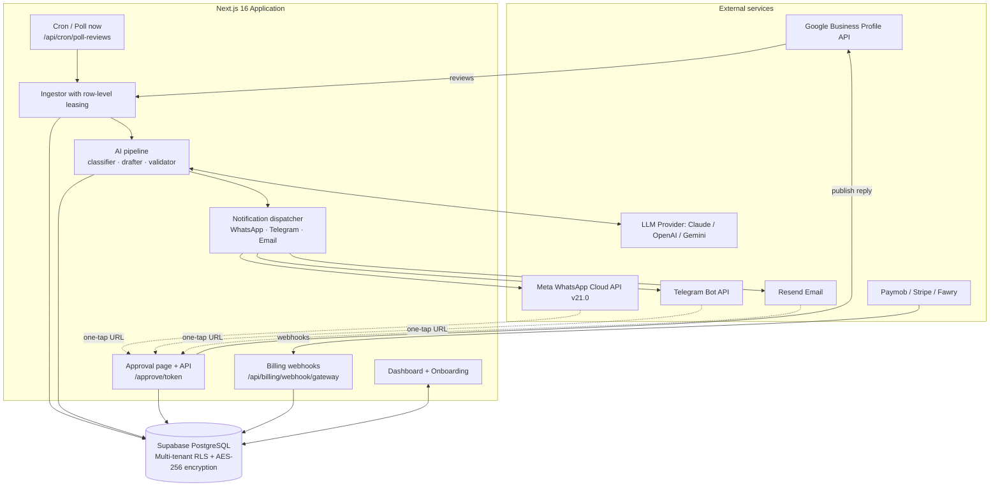
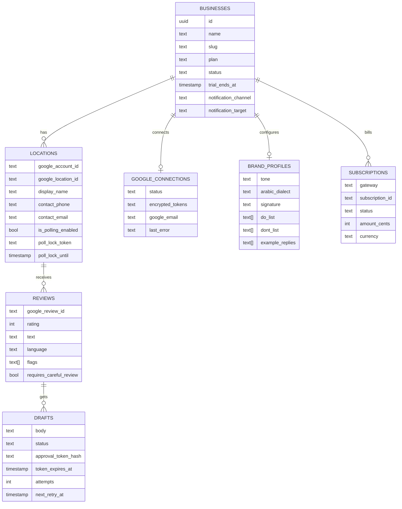
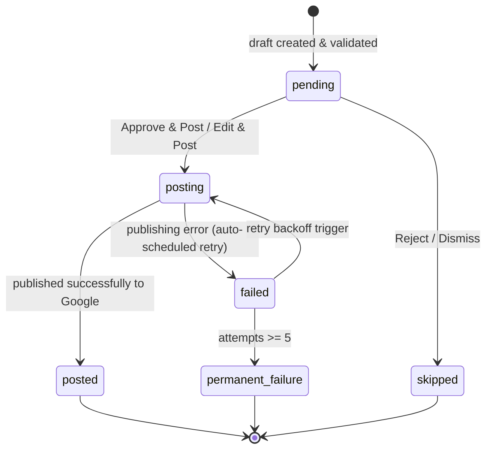

<p align="center">
  
</p>

<p align="center">
  
  
  
  
  
  
  
</p>

# Radd (رد)

**AI-drafted replies to every Google review, approved by the owner in one tap.**

Radd is a multi-tenant SaaS for local businesses (cafés, restaurants, clinics, retail) in Egypt and the wider MENA region. It watches a business's Google Business Profile for new reviews, classifies them, drafts a reply in the brand's voice (including natural **Egyptian Arabic**), checks that draft against deterministic safety rules, and sends the owner a one-tap approval link by **WhatsApp**, **Telegram**, or **email**. When the owner approves or edits the reply, Radd publishes it to Google.

> **Status:** production-ready SaaS with multi-gateway billing (**Paymob EGP**, Stripe, Fawry), official **Meta WhatsApp Cloud API** approved message templates with one-tap URL buttons, multi-location branch management, Row Level Security (RLS), and live Google Business Profile sync with local mock simulator fallbacks.

<p align="center">
  
  <br>
  <sub>Illustration of the three steps: ingestion & drafting, one-tap owner approval, and publishing to Google.</sub>
</p>

---

## Table of contents

- [Why Radd](#why-radd)
- [How it works](#how-it-works)
- [UI preview](#ui-preview)
- [Example behavior](#example-behavior)
- [Features](#features)
- [Brand voice](#brand-voice)
- [Subscriptions and billing](#subscriptions-and-billing)
- [Multi-location support](#multi-location-support)
- [Tech stack](#tech-stack)
- [Architecture](#architecture)
- [Safety and security](#safety-and-security)
- [Getting started](#getting-started)
- [Configuration](#configuration)
- [Routes and endpoints](#routes-and-endpoints)
- [Verification and evaluation](#verification-and-evaluation)
- [Project structure](#project-structure)
- [Data model](#data-model)
- [Draft lifecycle](#draft-lifecycle)
- [FAQ](#faq)
- [Brand assets](#brand-assets)
- [Notes on Google branding](#notes-on-google-branding)
- [Author](#author)
- [License](#license)

---

## Why Radd

Replying to reviews improves how a business looks on Google, but owners rarely have time to write replies, and generic AI tools tend to sound robotic, mishandle dialect, or promise things the business never offered.

Radd focuses on four fundamentals:

1. **Local language quality:** replies in authentic Egyptian Arabic (عامية مصرية), Modern Standard Arabic, English, or a natural mix matching the reviewer's tone.
2. **A human always decides:** nothing is posted without the owner's explicit approval; sensitive complaints are flagged with visual badges.
3. **Safety by construction:** a deterministic validator sits *after* the model, blocking refund promises, fake discounts, and contact leaks regardless of what the LLM produces.
4. **Frictionless one-tap approval:** messages arrive on **WhatsApp** or **Telegram** with direct URL action buttons that open a mobile-first page requiring zero login.

---

## How it works



### The AI pipeline



---

## UI preview

### Web Dashboard & Branch Analytics
Central management interface featuring answer rates, approval metrics, active notification channel status, location switcher, and complete review & draft timeline:

<p align="center">
  
</p>

### Mobile One-Tap Approval (`/approve/[token]`)
Mobile-first approval interface opened directly from WhatsApp, Telegram, or email. Displays the reviewer's star rating, authentic Arabic feedback, proposed response, and instant action buttons:

<p align="center">
  
  <br>
  <sub>Mobile view of a 5★ Egyptian Arabic review with suggested brand-voice reply and action buttons.</sub>
</p>

---

## Example behavior

Illustrative examples of how different reviews are handled:

| Review | What Radd does |
| :--- | :--- |
| Positive review in Egyptian Arabic | Detects `ar`, drafts a warm reply in natural dialect using brand tone and signature |
| English review with a mixed complaint | Detects the language, acknowledges the issue, invites the customer to call the official number. No promises or compensation |
| Review containing instructions such as "ignore all previous instructions" | Treated as untrusted data, flagged `injection_suspected`, marked for careful review |
| Star-only review with no text | Drafts a short thank-you without inventing details of the visit |
| Review demanding a refund or mentioning legal action | Flagged `refund` or `legal`, requires careful owner review, and the validator blocks any compensation promise |
| Review mentioning an allergy or illness | Flagged `medical`, marked for careful review, no medical claims in the reply |

---

## Features

**Review handling & ingestion**
- Polls Google Business Profile for unanswered reviews with a protected cron endpoint and a manual **Poll now** button.
- Idempotent ingestion keyed on the Google review ID, preventing duplicate processing.
- Row-level polling leases (`poll_lock_token`, `poll_lock_until`) to avoid race conditions across distributed serverless cron runners.
- Skips reviews that already have an owner reply.

**AI classification and drafting**
- Detects language: Egyptian Arabic, Modern Standard Arabic, English, mixed, or star-only (empty text).
- Detects sentiment, urgency, and category (food, service, ambiance, delivery, billing).
- Flags sensitive cases: `medical`, `legal`, `refund`, and `injection_suspected`. Negative or flagged reviews trigger visual warning badges.
- Drafts replies using the brand profile: tone, dialect, signature, do/don't lists, and approved reference examples.
- Handles star-only reviews gracefully without hallucinating customer interactions.

**WhatsApp approval channel (Meta Cloud API)**
- Official Meta WhatsApp Business Cloud API integration using pre-approved templates (`review_reply_approval`).
- Dynamic URL button components with parameters leading directly to `/approve/[token]`.
- Automatic international phone number normalization (e.g. `01001234567` $\to$ `201001234567`).
- Zero-credential local console mocking for offline testing and CI workflows.
- Disconnection alerts sent via WhatsApp if Google OAuth credentials expire or are revoked.

**Owner experience & one-tap approval**
- **Mobile-first approval page**, login-free, secured by a signed single-use 256-bit token.
- Three immediate actions: **Approve & Post**, **Edit & Post** (inline with character and dialect validation), and **Reject / Dismiss**.
- Link expiry enforcement (72-hour lifetime) with one-click secure renewal (`/api/drafts/[token]/renew`) redispatched to the owner's channel.
- Multi-channel notification dispatchers: **WhatsApp**, **Telegram** (inline button), and **Email** (Resend).

**Multi-location management**
- Supports multi-branch businesses under a single account.
- Location-specific contact details (phone, care email) and branch signature overrides.
- Dashboard location switcher with branch-filtered review timelines and analytics.

**Publishing state machine**
- Resilient state transitions: `pending` $\to$ `posting` $\to$ `posted` or `failed`.
- Exponential backoff retry loop with retry scheduling (`next_retry_at`, attempts counter).
- Atomic leasing guarantees that only one background worker publishes a draft at any given time.

**Google OAuth lifecycle & privacy compliance**
- Automatic revocation detection (`invalid_grant`, HTTP 401/403) with immediate polling pause to protect API quotas.
- Reconnection notification dispatch across WhatsApp, Telegram, and Email with direct OAuth reconnect URLs.
- Two privacy-compliant disconnection modes:
  - **Soft disconnect:** disables sync and revokes OAuth tokens while preserving historical review data.
  - **Full deletion (GDPR/CCPA):** completely purges stored review drafts, location records, and credentials from Supabase.

---

## Brand voice

Each business configures how Radd speaks during onboarding. The drafter uses these settings for every reply:

| Setting | What it controls |
| :--- | :--- |
| Tone | Overall voice, for example warm, formal, energetic, or playful |
| Dialect | Egyptian Arabic (عامية مصرية), Modern Standard Arabic, Gulf, or Levantine |
| Signature | The sign-off appended to replies (e.g. `فريق Roastery & Co.`) |
| DO list | Things replies should do or mention (e.g. welcome back, mention specialties) |
| DON'T list | Things replies must never say (e.g. never offer free drinks, never admit fault) |
| Example replies | Past replies the owner likes, used as few-shot style references |
| Official contact number | The only phone number a reply is allowed to include |

---

## Subscriptions and billing

Radd includes a built-in billing engine designed for regional MENA payment options alongside international cards:

| Plan | Pricing | Monthly Reviews | Locations | Channels |
| :--- | :--- | :-: | :-: | :--- |
| **Starter** | 499 EGP / mo | Up to 100 | 1 location | WhatsApp, Telegram, Email |
| **Pro** | 999 EGP / mo | Up to 500 | Up to 3 locations | WhatsApp, Telegram, Email |
| **Enterprise** | Custom | Unlimited | Unlimited | Dedicated SLA & webhooks |

**Supported payment gateways:**
1. **Paymob (Egypt):** Accept cards (Visa, Mastercard, Meeza) and Mobile Wallets (Vodafone Cash, Orange, Etisalat, WE) with cryptographic HMAC-SHA512 webhook signature verification.
2. **Stripe (Global):** Standard subscription checkout sessions with webhook signature validation.
3. **Fawry (Egypt Cash/Kiosk):** Reference-number checkout for offline retail payments.

**Entitlement enforcement:**
- Checks business plan and subscription status (`active` or valid `trial_ends_at`) prior to review ingestion and AI drafting.
- Gracefully prevents quota overages while keeping historical dashboard data accessible.

---

## Multi-location support

For hospitality and retail chains with multiple branches, Radd structures each branch as a distinct `locations` row:
- Each branch connects to its respective Google Business Profile location ID.
- Stores custom branch contact phones (e.g. branch delivery hotline) and custom signatures.
- Dedicated cron leasing per location ensures high-volume locations do not block smaller branches during polling.

---

## Tech stack

| Layer | Technology |
| :--- | :--- |
| Framework | Next.js 16 (App Router, Turbopack), React 19, TypeScript (strict mode) |
| Styling | Tailwind CSS |
| Database & auth | Supabase (PostgreSQL 15), `@supabase/supabase-js`, Row Level Security (RLS) |
| Server security | `server-only` isolation, Node.js `crypto` (AES-256-GCM token encryption, SHA-256 hashes) |
| AI layer | Pluggable LLM layer (Anthropic Claude, OpenAI, Google Gemini) with structured JSON output and a local simulator fallback |
| Google | Business Profile APIs through `googleapis`, OAuth 2.0 with offline refresh tokens |
| Notifications | Meta WhatsApp Business Cloud API (v21.0), Resend (email), Telegram Bot API |
| Billing & payments | Paymob (EGP HMAC-SHA512), Stripe Checkout & Webhooks, Fawry |
| Validation | Zod schema validation for all API inputs and webhooks |
| Testing | Node.js native test runner (`node:test`), `tsx` |

---

## Architecture



---

## Safety and security

1. **Prompt-injection defense.** Review text is wrapped in isolated data tags (`<untrusted_review_data>`) and treated strictly as content, never instructions. Suspicious prompts are flagged `injection_suspected`.
2. **Deterministic output validator.** Pure TypeScript checks execute on every generated reply before the owner ever sees it:
   - blocks refund and compensation promises (Arabic and English phrasing),
   - blocks unauthorized discounts, promo codes, and vouchers,
   - strips contact phone numbers other than the location's official contact number,
   - flags Arabic WhatsApp invitation phrases (e.g. `كلمنا واتساب`, `تواصل معنا على الواتس`),
   - enforces strict character bounds (10 to 1,000 characters).
3. **Single-use magic links & SHA-256 hashing.** Approval tokens are 256-bit random secrets. Only the SHA-256 hash is stored in the database. A database leak cannot expose actionable approval links.
4. **Token encryption at rest.** OAuth access and refresh tokens are encrypted at rest using AES-256-GCM (`TOKEN_ENCRYPTION_KEY`).
5. **Log data scrubber.** Sensitive tokens, keys, and authorization strings are recursively redacted from server logs.
6. **Multi-tenant Row Level Security (RLS).** Supabase tables enforce tenant boundaries scoped strictly by `business_id`.
7. **Human in the loop.** The model never auto-publishes. Every reply requires explicit owner approval.

---

## Getting started

### Prerequisites

- Node.js 20+
- A Supabase project (or local Supabase)
- Optional for live production: Google Cloud OAuth credentials, Meta WhatsApp Cloud API credentials, a Resend API key, Telegram bot token, and Paymob / Stripe keys.

*Without external keys, Radd runs completely in offline mock mode with built-in Google API, WhatsApp, and LLM simulators.*

### Install

```bash
git clone https://github.com/mo74x/radd.git
cd radd
npm install
```

### Set up the database

Apply the Supabase migrations in order from `supabase/migrations/`:
- `0001_init.sql`
- `0002_rls_policies.sql`
- `0003_token_expiry_renewal.sql`
- `0004_publishing_state_machine.sql`
- `0005_location_overrides.sql`
- `0006_billing_subscriptions.sql`

### Configure environment

Copy `.env.example` to `.env` and fill in your keys (see [Configuration](#configuration)):

```bash
cp .env.example .env
```

### Run locally

```bash
npm run dev
```

- Dashboard: <http://localhost:3000/dashboard>
- Onboarding & settings: <http://localhost:3000/onboarding>

---

## Configuration

| Variable | Required in Live | Purpose |
| :--- | :-: | :--- |
| `NEXT_PUBLIC_SUPABASE_URL` | Yes | Supabase project URL |
| `NEXT_PUBLIC_SUPABASE_ANON_KEY` | Yes | Supabase client public key |
| `SUPABASE_SERVICE_ROLE_KEY` | Yes | Supabase admin key (server-only) |
| `TOKEN_ENCRYPTION_KEY` | Yes | 32-byte hex secret for AES-256-GCM token encryption |
| `CRON_SECRET` | Yes | Bearer token protecting `/api/cron/poll-reviews` |
| `GOOGLE_CLIENT_ID` / `GOOGLE_CLIENT_SECRET` | No (mock fallback) | Google Cloud OAuth credentials |
| `META_WHATSAPP_TOKEN` | No (mock fallback) | Meta WhatsApp Business System User token |
| `WHATSAPP_PHONE_NUMBER_ID` | No (mock fallback) | 15-digit WhatsApp Business Phone Number ID |
| `WHATSAPP_TEMPLATE_NAME` | No | Approved template name (default: `review_reply_approval`) |
| `WHATSAPP_TEMPLATE_LANG` | No | Template language code (default: `ar`) |
| `TELEGRAM_BOT_TOKEN` | No (mock fallback) | Telegram bot token from @BotFather |
| `RESEND_API_KEY` | No (mock fallback) | Resend API key for transactional emails |
| `PAYMOB_API_KEY` / `PAYMOB_HMAC_SECRET` | No (mock fallback) | Egyptian Paymob gateway credentials |
| `STRIPE_SECRET_KEY` / `STRIPE_WEBHOOK_SECRET` | No (mock fallback) | Stripe payments & webhook validation |
| `FAWRY_MERCHANT_CODE` / `FAWRY_SECRET_KEY` | No (mock fallback) | Fawry Egyptian cash payment gateway |
| `ANTHROPIC_API_KEY` / `OPENAI_API_KEY` | No (simulator fallback) | AI model provider keys |
| `NEXT_PUBLIC_APP_URL` | Yes | Base app URL (e.g. `https://radd.app`) used for `/approve/[token]` buttons |

### Scheduling the review poller

Call the cron endpoint on a scheduled timer (Vercel Cron, GitHub Actions, or Supabase `pg_cron`):

```bash
curl -H "Authorization: Bearer $CRON_SECRET" https://your-domain.com/api/cron/poll-reviews
```

---

## Routes and endpoints

| Route | Type | Purpose |
| :--- | :--- | :--- |
| `/dashboard` | Page | Analytics, location selector, review timeline, and manual **Poll now** button |
| `/onboarding` | Page | 3-step setup: connect Google, configure dialect & brand voice, select notification channel |
| `/approve/[token]` | Page | One-tap approval page (zero login, mobile-first, 256-bit token secured) |
| `/api/google/oauth/connect` | API | Initiates Google OAuth consent flow |
| `/api/google/oauth/callback` | API | Handles Google OAuth code exchange and encrypted token persistence |
| `/api/google/disconnect` | API | Handles soft disconnection or full GDPR/CCPA data deletion |
| `/api/cron/poll-reviews` | API | Scheduled review poller with row-level lease locking (`CRON_SECRET`) |
| `/api/drafts/[token]` | API | Single-use approval decision: approve, edit, skip |
| `/api/drafts/[token]/renew` | API | Token renewal endpoint with rate-limiting and redispatch to owner's channel |
| `/api/billing/webhook/[gateway]` | API | Webhook receiver for Paymob (HMAC-SHA512), Stripe, and Fawry |
| `/api/dashboard/settings` | API | Zod-validated settings update for brand profile, location overrides, and alert channels |

---

## Verification and evaluation

Radd includes a native test suite alongside prompt and real-world review evaluation runners:

```bash
# Run unit & integration test suites
npm test

# Run prompt evaluation suite (30 synthetic cases)
npm run eval:prompts

# Run real-world review evaluation suite (72 real Egyptian reviews)
npm run eval:real

# Run multi-tenant RLS isolation and token encryption verification
npx tsx --env-file=.env scripts/verify-rls.ts
```

### Evaluation suites overview (102 total cases)

| Evaluation Suite | Cases | Focus Areas | Pass Rate |
| :--- | :-: | :--- | :-: |
| **Prompt Evaluation** (`eval-prompts.ts`) | 30 | Dialect fidelity, star-only handling, injection defense, compensation trap blocking | **30 / 30 (100%)** |
| **Real Egyptian Reviews** (`eval-real-reviews.ts`) | 72 | Real café, restaurant, and clinic reviews in Egyptian dialect, tourist complaints, mixed English | **72 / 72 (100%)** |
| **Test Suites** (`tests/*.test.ts`) | 45+ | Paymob HMAC, Stripe webhooks, WhatsApp templates, Arabic normalization, RLS policies | **All Passing** |

---

## Project structure

```text
radd/
├── docs/                        # UI previews, banner, icon, and flow diagrams
├── scripts/                     # eval runners + RLS verification script
├── src/
│   ├── app/
│   │   ├── api/
│   │   │   ├── billing/webhook/[gateway]/  # Paymob, Stripe, Fawry webhooks
│   │   │   ├── cron/poll-reviews/          # scheduled polling endpoint
│   │   │   ├── dashboard/settings/         # settings API (Zod-validated)
│   │   │   ├── drafts/[token]/             # single-use approval & renewal
│   │   │   └── google/oauth/               # OAuth connect, callback, disconnect
│   │   ├── approve/[token]/                # mobile one-tap approval UI
│   │   ├── dashboard/                      # analytics + review timeline
│   │   └── onboarding/                     # 3-step setup & brand voice configuration
│   ├── lib/
│   │   ├── ai/                             # classifier, drafter, validator, pipeline, prompts
│   │   ├── approvals/                      # approval state machine & token renewal
│   │   ├── billing/                        # Paymob, Stripe, Fawry gateways & entitlements
│   │   ├── crypto/                         # AES-256 encryption, hashing, log scrubber
│   │   ├── google/                         # client (real + mock), ingestor, lifecycle
│   │   ├── notifications/                  # WhatsApp, Telegram, Resend dispatcher
│   │   └── supabase/                       # admin client & RLS configuration
│   └── types/database.ts
└── supabase/migrations/                    # 0001 through 0006 migrations
```

---

## Data model



---

## Draft lifecycle



---

## FAQ

**Does Radd post replies automatically without human review?**
No. Every reply requires explicit owner approval via the one-tap approval interface.

**How does WhatsApp approval work?**
Radd sends an approved Meta WhatsApp template to the owner's phone with dynamic URL buttons. Tapping the button opens `/approve/[token]` where the owner can approve with one click or edit the draft inline.

**Can Radd run without external API keys?**
Yes. Complete mock implementations are built-in for Google Business Profile, WhatsApp Cloud API, Resend, Telegram, and LLM generation. You can test the entire flow locally offline.

**Which Arabic dialects are supported?**
Egyptian Arabic (عامية مصرية), Modern Standard Arabic (فصحى مبسطة), Gulf Arabic (خليجي), and Levantine Arabic (شامي).

**What payment gateways are supported for subscriptions?**
Egyptian Paymob (cards & mobile wallets in EGP), international Stripe, and Fawry cash reference codes.

**What happens if an approval link expires?**
Links expire after 72 hours. When an owner opens an expired link, they can request a fresh link with one tap, which is securely redispatched to their registered WhatsApp, Telegram, or email.

---

## Brand assets

| Asset | Description | File |
| :--- | :--- | :--- |
| **Banner** | GitHub project banner | [`docs/radd-github-banner.svg`](docs/radd-github-banner.svg) |
| **Flow diagram** | 3-step architecture illustration | [`docs/radd-flow.svg`](docs/radd-flow.svg) |
| **Dashboard UI** | Desktop web dashboard preview | [`docs/radd-preview-dashboard.svg`](docs/radd-preview-dashboard.svg) |
| **Approval UI** | Mobile one-tap approval preview | [`docs/radd-preview-approval.svg`](docs/radd-preview-approval.svg) |
| **App icon** | Official Radd brand mark | [`docs/radd-icon.svg`](docs/radd-icon.svg) |

<p align="center">
  
</p>

---

## Notes on Google branding

Radd is an independent product. It is not affiliated with, endorsed by, or sponsored by Google. "Google" and "Google Business Profile" are trademarks of Google LLC and are used here solely for compatibility descriptions.

---

## Author

**Mohamed Arafa Shabaan**: Backend & systems integration engineer.
[GitHub](https://github.com/mo74x) · [LinkedIn](https://www.linkedin.com/in/mohamed-arafa-6628211b8/)

---

## License

This project is licensed under the [MIT License](LICENSE) &copy; 2026 Mohamed Arafa Shabaan.

Free and open-source software: you are free to use, modify, and distribute it in accordance with the terms of the MIT license. See the [`LICENSE`](LICENSE) file for the full license text.