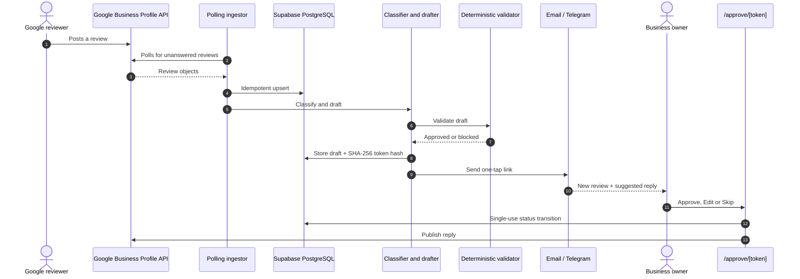
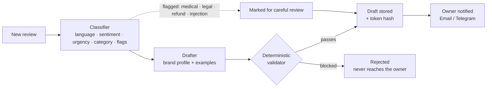
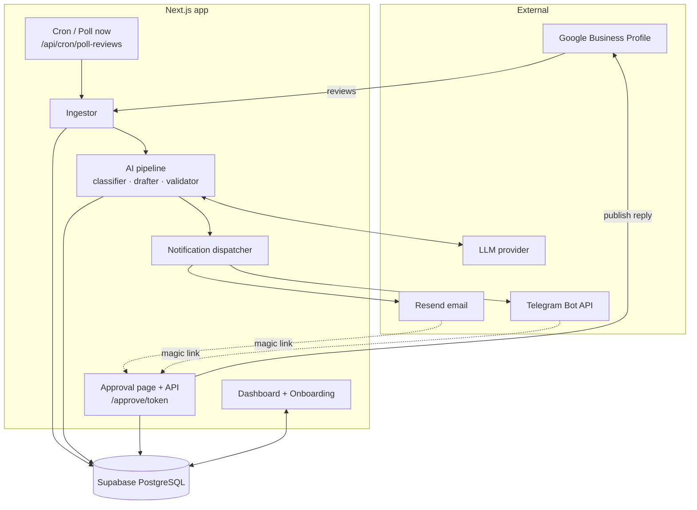
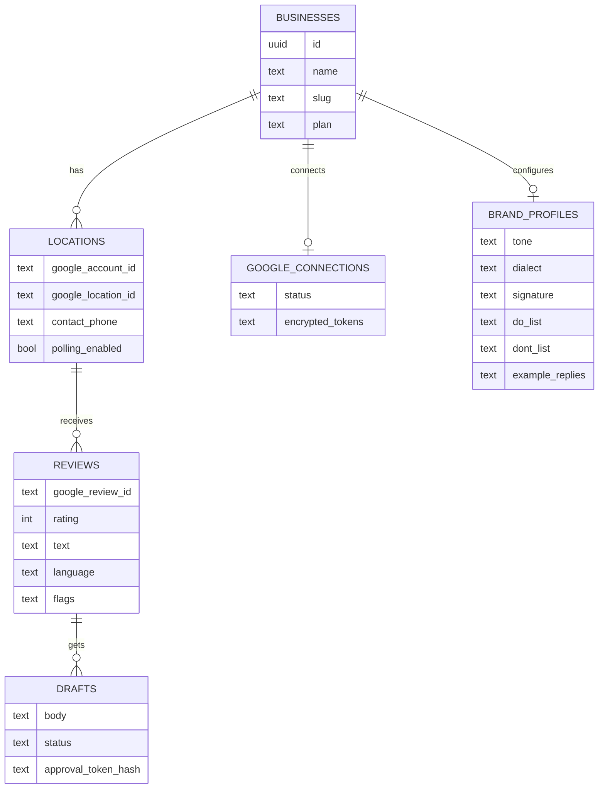
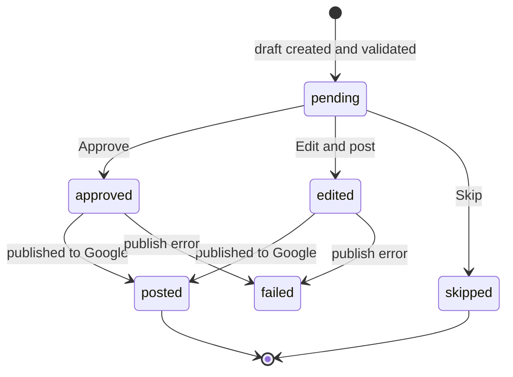

<p align="center">
  
</p>

<p align="center">
  
  
  
  
  
  
</p>

# Radd (رد)

**AI-drafted replies to every Google review, approved by the owner in one tap.**

Radd is a multi-tenant SaaS for local businesses (cafés, restaurants, clinics, retail) in Egypt and the wider MENA region. It watches a business's Google Business Profile for new reviews, classifies them, drafts a reply in the brand's voice (including natural **Egyptian Arabic**), checks that draft against deterministic safety rules, and sends the owner a one-tap approval link by email or Telegram. When the owner approves or edits the reply, Radd publishes it to Google.

> **Status:** feature-complete MVP, developed and tested locally against a built-in mock of the Google Business Profile API. Live Google access depends on Google's API access and OAuth verification process.

<p align="center">
  
  <br>
  <sub>Illustration of the three steps (not a real screenshot).</sub>
</p>

---

## Table of contents

- [Why Radd](#why-radd)
- [How it works](#how-it-works)
- [Example behavior](#example-behavior)
- [Features](#features)
- [Brand voice](#brand-voice)
- [Tech stack](#tech-stack)
- [Architecture](#architecture)
- [Safety and security](#safety-and-security)
- [Getting started](#getting-started)
- [Configuration](#configuration)
- [Routes and endpoints](#routes-and-endpoints)
- [Verification and evaluation](#verification-and-evaluation)
- [Project structure](#project-structure)
- [Data model](#data-model)
- [Draft lifecycle](#draft-lifecycle)
- [FAQ](#faq)
- [Brand assets](#brand-assets)
- [Notes on Google branding](#notes-on-google-branding)
- [Author](#author)

---

## Why Radd

Replying to reviews improves how a business looks on Google, but owners rarely have time to write replies, and generic AI tools tend to sound robotic, mishandle dialect, or promise things the business never offered.

Radd focuses on three things:

1. **Local language quality:** replies in natural Egyptian Arabic, English, or a mix, matching the reviewer.
2. **A human always decides:** nothing is posted without the owner's approval, and risky reviews are clearly flagged.
3. **Safety by construction:** a deterministic validator sits *after* the model, so refund promises, discount codes and stray phone numbers are blocked no matter what the model produces.

---

## How it works



### The AI pipeline



---

## Example behavior

Illustrative examples of how different reviews are handled:

| Review | What Radd does |
| :--- | :--- |
| Positive review in Egyptian Arabic | Detects `ar`, drafts a warm reply in natural dialect using the brand tone and signature |
| English review with a mixed complaint | Detects the language, acknowledges the issue, invites the customer to contact the business at the official number. No promises or compensation |
| Review containing instructions such as "ignore all previous instructions" | Treated as untrusted data, flagged `injection_suspected`, marked for careful review |
| Star-only review with no text | Drafts a short thank-you without inventing details of the visit |
| Review demanding a refund or mentioning legal action | Flagged `refund` or `legal`, requires careful owner review, and the validator blocks any refund or compensation promise in the draft |
| Review mentioning an allergy or illness | Flagged `medical`, marked for careful review, no medical claims in the reply |

---

## Features

**Review handling**
- Polls Google Business Profile for unanswered reviews, with a protected cron endpoint and a manual **Poll now** button.
- Idempotent ingestion keyed on the Google review ID, so a review is never processed twice.
- Skips reviews that already have an owner reply.

**AI classification and drafting**
- Detects language: Egyptian Arabic, English, mixed, or no text (star-only).
- Detects sentiment, urgency and category (food, service, ambiance, delivery, billing).
- Flags sensitive cases: `medical`, `legal`, `refund`, and `injection_suspected`. Negative or flagged reviews are marked for careful review.
- Drafts replies using the brand profile: tone, dialect, signature, do/don't lists and example replies.
- Handles star-only reviews without inventing details the reviewer never wrote.

**Owner experience**
- **One-tap approval page**, mobile-first and login-free, secured by a signed single-use token.
- Three actions: **Approve**, **Edit reply** (in place), **Skip**.
- Warning banner when a review needs careful handling.
- Notifications by **email (Resend)** and **Telegram** (inline action button).
- 3-step onboarding: connect Google, set brand voice, choose notification channel.

**Dashboard**
- Reviews answered %, approved-without-edit %, pending count, active notification channel.
- Full review and reply timeline with ratings, languages, flags and model versions.

<!--
Add real screenshots to docs/screenshots/ and uncomment:

| Dashboard | Onboarding | One-tap approval |
| :---: | :---: | :---: |
|  |  |  |
-->

---

## Brand voice

Each business configures how Radd speaks during onboarding. The drafter uses these settings for every reply:

| Setting | What it controls |
| :--- | :--- |
| Tone | Overall voice, for example warm, formal or playful |
| Dialect | Egyptian Arabic, or other Arabic and English choices |
| Signature | The sign-off appended to replies |
| DO list | Things replies should do or mention |
| DON'T list | Things replies must never say |
| Example replies | Past replies the owner likes, used as style references |
| Official contact number | The only phone number a reply is allowed to include |

---

## Tech stack

| Layer | Technology |
| :--- | :--- |
| Framework | Next.js 16 (App Router, Turbopack), React 19, TypeScript |
| Styling | Tailwind CSS |
| Database and auth | Supabase (PostgreSQL 15), `@supabase/supabase-js`, Row Level Security |
| AI | Pluggable LLM layer (Anthropic Claude, OpenAI, Google Gemini) with structured JSON output and a local simulator fallback |
| Google | Business Profile APIs through `googleapis`, OAuth 2.0 |
| Notifications | Resend (email), Telegram Bot API |
| Security | Node.js `crypto` (256-bit random tokens, SHA-256 hashing) |
| Validation | Zod |
| Scripts | `tsx` |

---

## Architecture



Everything is stored in Supabase. Each business is a tenant: locations, brand profiles, reviews and drafts all belong to a `business_id`.

---

## Safety and security

1. **Prompt-injection defense.** Review text is wrapped in isolated data tags (`<untrusted_review_data>`) and treated as content, never as instructions. Suspicious reviews are flagged `injection_suspected`.
2. **Deterministic output validator.** Pure TypeScript checks run on every generated reply before it reaches the owner:
   - blocks refund and compensation promises (English and Arabic phrasing),
   - blocks unauthorized discounts, vouchers and codes,
   - strips phone numbers other than the location's official contact number,
   - enforces length bounds (10 to 1,000 characters).
3. **Single-use magic links.** Approval tokens are 256-bit random values. Only the SHA-256 hash is stored, so a database leak does not expose usable links. A decision is applied through an atomic `status = 'pending'` check, which blocks double taps and replays.
4. **Human in the loop.** The model never publishes on its own. Every reply needs an explicit owner decision.
5. **Tenant isolation.** All business data is scoped by `business_id`, with RLS policies on the database tables.

---

## Getting started

### Prerequisites

- Node.js 20+
- A Supabase project (or local Supabase)
- Optional for live mode: Google Cloud OAuth credentials, a Resend API key, a Telegram bot token, and an LLM API key

Without the optional keys, Radd falls back to the built-in mock Google client, a console notification mock, and a local LLM simulator, so you can run the whole flow offline.

### Install

```bash
git clone https://github.com/mo74x/review-reply-bot.git
cd review-reply-bot
npm install
```

### Set up the database

Apply the schema in `supabase/migrations/0001_init.sql` to your Supabase project (SQL editor or the Supabase CLI).

### Configure environment

Copy the example environment file and fill in the values (see [Configuration](#configuration)):

```bash
cp .env.example .env
```

### Run

```bash
npm run dev
```

- Dashboard: <http://localhost:3000/dashboard>
- Onboarding and brand voice: <http://localhost:3000/onboarding>

---

## Configuration

| Variable | Purpose |
| :--- | :--- |
| `NEXT_PUBLIC_SUPABASE_URL` | Supabase project URL |
| `NEXT_PUBLIC_SUPABASE_ANON_KEY` | Supabase public key |
| `SUPABASE_SERVICE_ROLE_KEY` | Service-role key for background jobs (server only, never expose) |
| `CRON_SECRET` | Bearer token protecting `/api/cron/poll-reviews` |
| `GOOGLE_CLIENT_ID` / `GOOGLE_CLIENT_SECRET` | Google OAuth credentials (omit to use the mock client) |
| `RESEND_API_KEY` | Email notifications (omit for console mock) |
| `TELEGRAM_BOT_TOKEN` | Telegram notifications (omit for console mock) |
| LLM provider key(s) | Anthropic / OpenAI / Gemini key (omit for local simulator) |
| App base URL | Used to build `/approve/{token}` links |

Check `.env.example` for the exact variable names used in the code.

### Scheduling the poller

Call the cron endpoint on a schedule (Vercel Cron, GitHub Actions or Supabase `pg_cron`):

```bash
curl -H "Authorization: Bearer $CRON_SECRET" https://your-domain.com/api/cron/poll-reviews
```

---

## Routes and endpoints

| Route | Type | Purpose |
| :--- | :--- | :--- |
| `/dashboard` | Page | Analytics and review timeline, with a **Poll now** button |
| `/onboarding` | Page | 3-step setup: connect Google, brand voice, notification channel |
| `/approve/[token]` | Page | One-tap approval page (no login, token-secured) |
| `/api/google/oauth/*` | API | Google OAuth connect and callback |
| `/api/cron/poll-reviews` | API | Scheduled review polling (bearer `CRON_SECRET`) |
| `/api/drafts/[token]` | API | Single-use approval decision: approve, edit, skip |
| `/api/dashboard/settings` | API | Zod-validated updates for business settings, brand profile and location contact details |

---

## Verification and evaluation

Each build phase has a runnable verification script, plus a prompt evaluation suite:

```bash
npx tsx --env-file=.env scripts/verify-foundation.ts   # database and token crypto
npx tsx --env-file=.env scripts/verify-part2.ts        # Google ingestion
npx tsx --env-file=.env scripts/verify-part3.ts        # classifier, drafter, validator
npx tsx --env-file=.env scripts/verify-part4.ts        # notifications and one-tap approval
npx tsx --env-file=.env scripts/eval-prompts.ts        # 30-case prompt evaluation
```

**Evaluation suite (30 cases):**

| Category | Cases |
| :--- | :-: |
| Egyptian Arabic, positive | 6 |
| Egyptian Arabic, complaints | 6 |
| Mixed Arabic and English | 6 |
| English (expat / tourist) | 5 |
| Adversarial: prompt injection, refund and legal traps | 4 |
| Star-only reviews with empty text | 3 |

Current result: **30/30 passing.** These cases were written by the project author, so treat the pass rate as a regression check on prompt and model changes.

---

## Project structure

```text
review-reply-bot/
├── docs/                        # banner, logo and illustrations
├── scripts/                     # verification + eval runners
├── src/
│   ├── app/
│   │   ├── api/
│   │   │   ├── cron/poll-reviews/     # scheduled polling endpoint
│   │   │   ├── dashboard/settings/    # settings API (Zod-validated)
│   │   │   ├── drafts/[token]/        # single-use approval decision
│   │   │   └── google/oauth/          # OAuth connect + callback
│   │   ├── approve/[token]/           # one-tap mobile approval page
│   │   ├── dashboard/                 # analytics + review timeline
│   │   └── onboarding/                # 3-step setup + brand voice
│   ├── lib/
│   │   ├── ai/                        # classifier, drafter, validator, pipeline, prompts
│   │   ├── approvals/                 # approval decisions + publishing
│   │   ├── crypto/                    # token generation + hashing
│   │   ├── google/                    # client (real + mock), ingestor, onboarding
│   │   ├── notifications/             # email + Telegram dispatcher
│   │   └── supabase/                  # admin + server clients
│   └── types/database.ts
└── supabase/migrations/0001_init.sql
```

---

## Data model



| Table | Purpose |
| :--- | :--- |
| `businesses` | Tenant root: name, slug, plan, notification settings |
| `google_connections` | OAuth tokens and connection status |
| `locations` | Store branches: Google account/location IDs, contact phone, polling toggle |
| `brand_profiles` | Tone, dialect, signature, do/don't rules, example replies |
| `reviews` | Raw review text, rating, reviewer, detected language, safety flags |
| `drafts` | Generated replies, status, and the approval token hash |

---

## Draft lifecycle



The `pending` check is atomic and the token is single-use: once a decision is made, any further request with the same link is rejected.

---

## FAQ

**Does Radd post replies automatically?**
No. Every reply needs the owner's explicit approve, edit or skip.

**What happens if a review tries to manipulate the AI?**
The review text is isolated as untrusted data, the classifier flags it, and the validator checks the output regardless.

**Can it run without API keys?**
Yes. Mock clients for Google, notifications and the LLM let you run and test the complete flow locally.

**Which languages are supported?**
Egyptian Arabic, English, and mixed Arabic and English reviews, plus star-only reviews with no text.

**Can a reply include a phone number or a discount?**
Only the location's official contact number is allowed. Discounts, vouchers and refund promises are blocked.

**Which AI provider does it use?**
The AI layer is pluggable (Anthropic Claude, OpenAI or Google Gemini).

---

## Brand assets

| Asset | File |
| :--- | :--- |
| Banner | `docs/radd-github-banner.svg` |
| Flow illustration | `docs/radd-flow.svg` |
| Lockup (light) | `docs/radd-lockup-light.svg` |
| Lockup (dark) | `docs/radd-lockup-dark.svg` |
| Lockup (mono) | `docs/radd-lockup-mono.svg` |
| App icon | `docs/radd-icon.svg` |

<p align="center">
  
</p>

---

## Notes on Google branding

Radd is an independent product. It is not affiliated with, endorsed by, or sponsored by Google. "Google" and "Google Business Profile" are trademarks of Google LLC and are used here only to describe compatibility.

---

## Author

**Mohamed Arafa Shabaan**: Backend and systems integration engineer.
[GitHub](https://github.com/mo74x) · [LinkedIn](https://www.linkedin.com/in/mohamed-arafa-6628211b8/)

---

## License

Add a `LICENSE` file before publishing and reference it here.