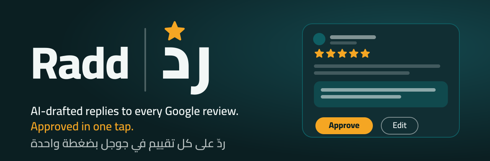
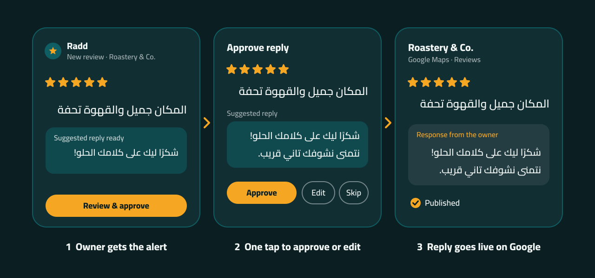
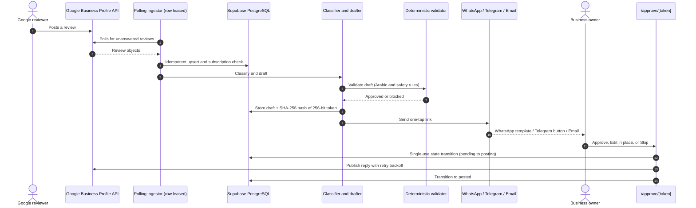
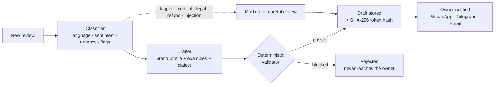
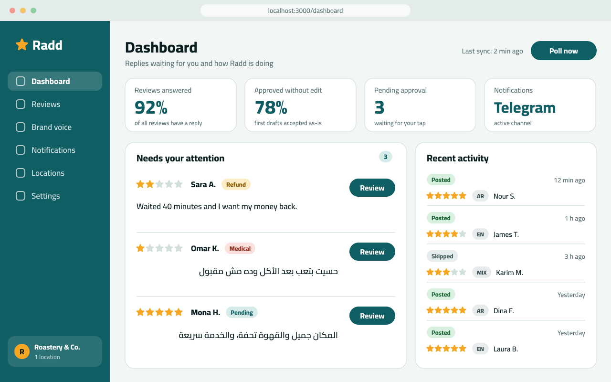
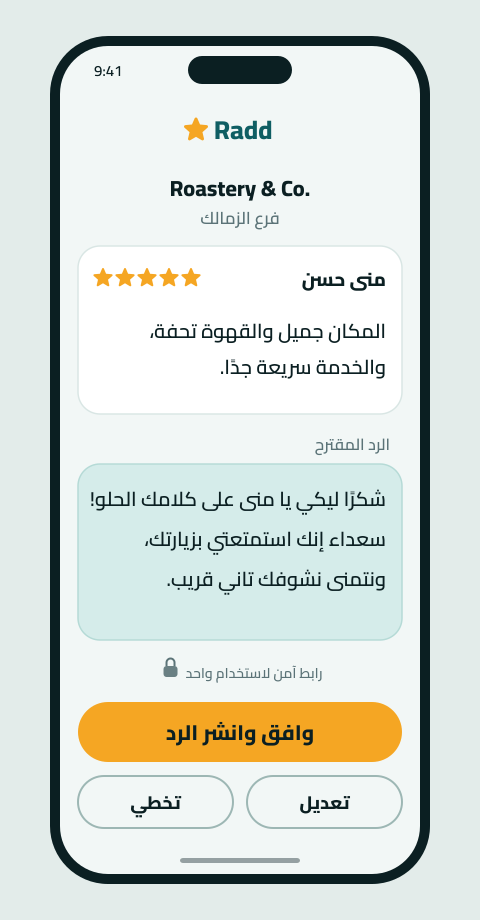
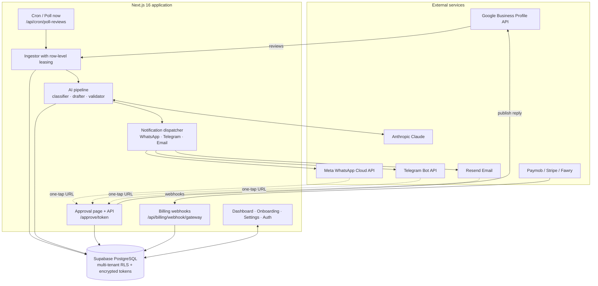
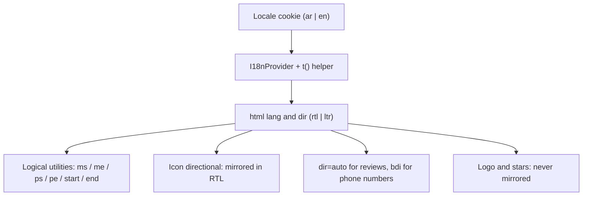
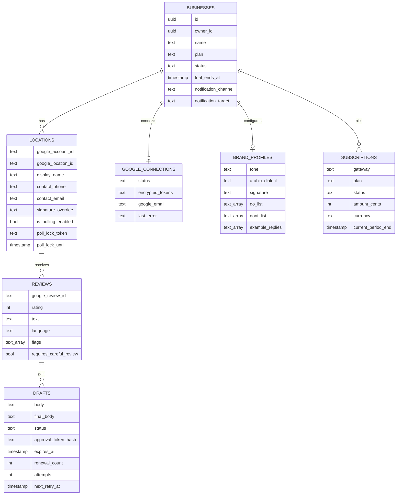
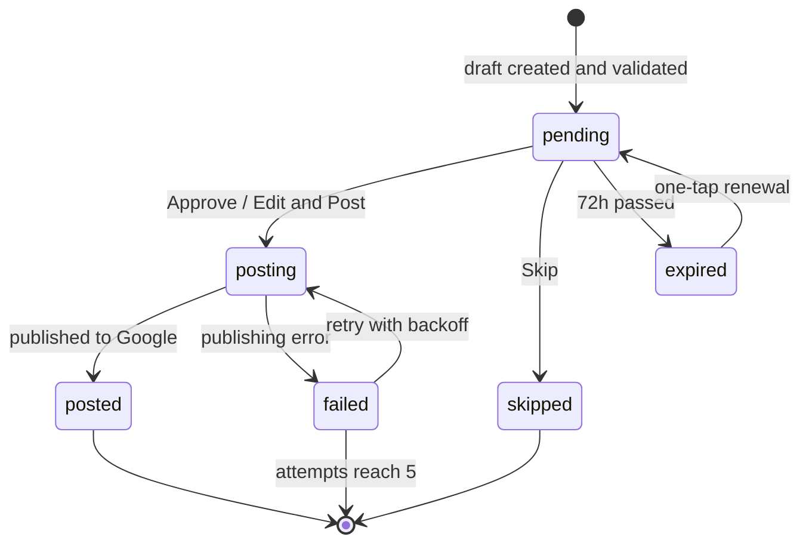

<p align="center">
  
</p>

<p align="center">
  <a href="https://github.com/mo74x/radd/actions/workflows/ci.yml"></a>
  
  
  
  
  
  
  
  
  
  
</p>

# Radd (ردّ)

**AI-drafted replies to every Google review, approved by the owner in one tap.**

Radd is a multi-tenant SaaS for local businesses (cafés, restaurants, clinics, retail) in Egypt and the wider MENA region. It watches a business's Google Business Profile for new reviews, classifies them, drafts a reply in the brand's voice (including natural **Egyptian Arabic**), checks the draft against deterministic safety rules, and sends the owner a one-tap approval link by **WhatsApp**, **Telegram**, or **email**. When the owner approves or edits the reply, Radd publishes it to Google.

> **Status:** feature-complete backend and a bilingual (Arabic RTL / English LTR) web UI: landing page, auth, onboarding wizard, dashboard, reviews, settings, and the mobile one-tap approval page. It is tested end to end against built-in simulators. Live Google and WhatsApp access depend on each provider's approval process. See [Limitations](#limitations).

<p align="center">
  
  <br>
  <sub>The three steps: ingestion and drafting, one-tap owner approval, and publishing to Google.</sub>
</p>

---

## Table of contents

- [Why Radd](#why-radd)
- [How it works](#how-it-works)
- [User interface](#user-interface)
- [Example behavior](#example-behavior)
- [Features](#features)
- [Brand voice](#brand-voice)
- [Subscriptions and billing](#subscriptions-and-billing)
- [Tech stack](#tech-stack)
- [Architecture](#architecture)
- [Safety and security](#safety-and-security)
- [Getting started](#getting-started)
- [Configuration](#configuration)
- [WhatsApp template setup](#whatsapp-template-setup)
- [Deployment](#deployment)
- [Routes and endpoints](#routes-and-endpoints)
- [Verification and evaluation](#verification-and-evaluation)
- [Project structure](#project-structure)
- [Data model](#data-model)
- [Draft lifecycle](#draft-lifecycle)
- [FAQ](#faq)
- [Limitations](#limitations)
- [Brand assets](#brand-assets)
- [Notes on Google branding](#notes-on-google-branding)
- [Author](#author)
- [License](#license)

---

## Why Radd

Replying to reviews improves how a business looks on Google, but owners rarely have time to write replies, and generic AI tools tend to sound robotic, mishandle dialect, or promise things the business never offered.

Radd focuses on four fundamentals:

1. **Local language quality:** replies in authentic Egyptian Arabic (عامية مصرية), Modern Standard Arabic, English, or a natural mix matching the reviewer's tone.
2. **A human always decides:** nothing is posted without the owner's explicit approval, and sensitive complaints are flagged with visual warnings.
3. **Safety by construction:** a deterministic validator sits *after* the model and blocks refund promises, fake discounts and contact leaks, whatever the LLM produces.
4. **One-tap approval:** messages arrive on **WhatsApp**, **Telegram** or email with a button that opens a mobile-first page. No login needed.

---

## How it works



### The AI pipeline



---

## User interface

The UI is built on a small in-house design system (`src/components/ui/`) with Tailwind CSS v4 and CSS-variable themes. No UI kit is used.

<p align="center">
  
  <br>
  <sub>Owner dashboard (design mockup): answer rate, approval metrics, notification channel, and review timeline.</sub>
</p>

<p align="center">
  
  <br>
  <sub>Mobile one-tap approval page (design mockup): the review, the suggested reply, and the actions.</sub>
</p>

> The two images above are SVG design mockups. To capture real screenshots of every approval state from a running dev server, use `npx tsx scripts/screenshot-approval-states.ts`.

### Design principles

| Area | Implementation |
| :--- | :--- |
| **Language and direction** | Arabic is the default (`<html lang="ar" dir="rtl">`), English switches to LTR. Choice is persisted in a cookie. Dictionaries live in `src/lib/i18n/messages/{ar,en}.ts`. |
| **RTL-safe layout** | Only logical utilities (`ms-*`, `me-*`, `ps-*`, `pe-*`, `start-*`, `end-*`, `text-start`, `text-end`). Directional icons flip with `<Icon directional />`. Logos and star ratings never flip. |
| **Bidi text** | Reviews and replies use `dir="auto"`. Phone numbers are isolated with `<bdi dir="ltr">`. Western digits (0-9) in both languages. |
| **Typography** | Cairo via `next/font` (Arabic + Latin subsets, weights 400 / 600 / 800), slightly taller line-height for Arabic. |
| **Colors** | Deep teal `#0F5E63` (primary), amber `#F5A623` (stars and primary CTA only), dark `#0B1F22`, off-white `#F2F7F6`. |
| **Themes** | Light and dark via CSS variables, following `prefers-color-scheme` with a manual toggle. |
| **Accessibility** | Touch targets of at least 44px, visible focus rings, labelled icon buttons, `prefers-reduced-motion` respected, WCAG AA contrast targets. |
| **Global states** | Branded inline-SVG illustrations for 404, 500, Google access revoked, trial ended, permission denied, expired / used links, and an offline notice. |

### Developer preview pages (development only)

> **Note:** These routes are strictly gated for development and return a 404 (`notFound()`) in production environments.

| Route | What it shows | Availability |
| :--- | :--- | :--- |
| `/dev/design-system` | Every UI component in all its states, in light/dark and ar/en | Development only |
| `/dev/email-preview` | The approval email (HTML and plain text) and the Telegram message, in Arabic, English, flagged and renewed-link variants | Development only |
| `/approve/preview-normal` | The approval page with sample data. Other states: `preview-careful`, `preview-editing`, `preview-success`, `preview-skipped`, `preview-used`, `preview-failed`, `preview-expired`. | Development only |

---

## Example behavior

Illustrative examples of how different reviews are handled:

| Review | What Radd does |
| :--- | :--- |
| Positive review in Egyptian Arabic | Detects `ar`, drafts a warm reply in natural dialect using brand tone and signature |
| English review with a mixed complaint | Acknowledges the issue and invites the customer to call the official number. No promises or compensation |
| Review containing "ignore all previous instructions" | Treated as untrusted data, flagged `injection_suspected`, marked for careful review |
| Star-only review with no text | Drafts a short thank-you without inventing details of the visit |
| Review demanding a refund or mentioning legal action | Flagged `refund` or `legal`, requires careful owner review, and the validator blocks any compensation promise |
| Review mentioning an allergy or illness | Flagged `medical`, marked for careful review, no medical claims in the reply |

---

## Features

**Review handling and ingestion**
- Polls Google Business Profile for unanswered reviews through a protected cron endpoint and a manual **Poll now** button.
- Idempotent ingestion keyed on the Google review ID, so nothing is processed twice.
- Row-level polling leases (`poll_lock_token`, `poll_lock_until`) prevent duplicate processing when cron runs overlap.
- Skips reviews that already have an owner reply.

**AI classification and drafting**
- Detects language: Arabic, English, mixed, or star-only (empty text).
- Detects sentiment, urgency and category (food, service, ambiance, delivery, billing).
- Flags sensitive cases: `refund`, `legal`, `medical`, `threat`, `abuse`, `injection_suspected`.
- Drafts replies from the brand profile: tone, dialect, signature, do/don't lists and example replies.
- Uses Anthropic Claude when `ANTHROPIC_API_KEY` is set, and a local simulator otherwise.

**Owner experience and one-tap approval**
- Mobile-first, login-free approval page secured by a single-use 256-bit token.
- Three actions: **Approve and Post**, **Edit and Post** (inline, 10 to 1,000 characters), and **Skip**.
- Owner edits run through the validator in warning mode: risky phrasing asks for confirmation instead of being silently blocked.
- Links expire after 72 hours and can be renewed with one tap (`/api/drafts/[token]/renew`, rate limited). The new link is sent only to the owner's registered channel.

**Notification channels**
- **WhatsApp:** Meta Cloud API message template with a dynamic URL button. See [WhatsApp template setup](#whatsapp-template-setup).
- **Telegram:** HTML message with escaped user text, truncated review snippet, and an inline "Review and approve" button.
- **Email (Resend):** table-based, inline-styled HTML (600px, dark-mode friendly, RTL/LTR per review language) with a plain-text alternative.
- Every channel falls back to a console mock when its credentials are missing.

**Multi-location management**
- Several branches under one account, each mapped to its own Google location.
- Per-branch contact phone, contact email and signature overrides.
- Location switcher with branch-filtered timelines and analytics.

**Publishing state machine**
- Transitions `pending` → `posting` → `posted` or `failed`.
- Exponential backoff retries (`next_retry_at`, `attempts`), up to 5 attempts.
- Atomic claiming, so only one worker publishes a given draft.

**Google OAuth lifecycle and data deletion**
- Detects revoked access (`invalid_grant`, HTTP 401/403), pauses polling and alerts the owner with a reconnect link.
- Two disconnection modes from Settings:
  - **Disconnect:** stops sync and revokes OAuth tokens while keeping history.
  - **Disconnect and delete:** purges drafts, reviews, locations and credentials.

**Accounts**
- Supabase Auth screens: sign in, sign up, forgot password, reset password, and email confirmation notice.

---

## Brand voice

Each business configures how Radd speaks during onboarding (and later in Settings). The drafter uses these settings for every reply:

| Setting | What it controls |
| :--- | :--- |
| Tone | Overall voice, for example warm, formal or energetic |
| Dialect | Egyptian Arabic (primary, evaluated) or Modern Standard Arabic. Gulf and Levantine can be selected but are not yet evaluated |
| Signature | The sign-off appended to replies (for example `فريق Roastery & Co.`) |
| DO list | Things replies should do or mention (for example welcome back, mention specialties) |
| DON'T list | Things replies must never say (for example never offer free drinks) |
| Example replies | Past replies the owner likes, used as style references |
| Official contact number | The only phone number a reply is allowed to include |

---

## Subscriptions and billing

Plans are defined in `src/lib/billing/types.ts`. New businesses start on a 14-day trial.

| Plan | EGP / month | USD / month | Branches included |
| :--- | :-: | :-: | :-: |
| **Starter** | 499 | 19 | 1 |
| **Pro** | 999 | 39 | 3 |
| **Agency** | 2,499 | 99 | 10 |

*Launch pricing, subject to change.*

**Payment gateways**
1. **Paymob (Egypt, EGP):** cards (Visa, Mastercard, Meeza) and mobile wallets through Unified Checkout, with HMAC-SHA512 webhook verification.
2. **Stripe (international):** checkout sessions with timestamped webhook signature validation.
3. **Fawry (Egypt):** reference-number payments for cash and kiosk, with callback signature validation.

**Entitlement enforcement**
- Checks the plan and subscription status (`active`, or a valid `trial_ends_at`) before ingestion and drafting.
- When a subscription is inactive, new drafts stop but historical dashboard data stays accessible.

---

## Tech stack

| Layer | Technology |
| :--- | :--- |
| Framework | Next.js 16 (App Router, Turbopack, Cache Components / Partial Prerendering), React 19, TypeScript (strict) |
| Styling | Tailwind CSS v4, CSS variables, Cairo (`next/font`), `lucide-react` icons |
| Database and auth | Supabase (PostgreSQL, Row Level Security), `@supabase/ssr`, `@supabase/supabase-js` |
| Server security | `server-only` isolation, Node.js `crypto` (AES-256-GCM, SHA-256) |
| AI | Anthropic Claude (`@anthropic-ai/sdk`, model set by `CLAUDE_MODEL`, default `claude-haiku-5-5`) with a local simulator fallback |
| Google | Business Profile APIs over `fetch`, OAuth 2.0 with offline refresh tokens |
| Notifications | Meta WhatsApp Cloud API, Telegram Bot API, Resend |
| Billing | Paymob, Stripe, Fawry |
| Validation | Zod |
| Testing | Node.js test runner (`node:test` via `tsx`), Playwright, ESLint |

---

## Architecture



### RTL / LTR rendering



---

## Safety and security

1. **Prompt-injection defense.** Review text is wrapped in isolated data tags and treated strictly as content, never instructions. Suspicious reviews are flagged `injection_suspected`.
2. **Deterministic output validator.** Pure TypeScript checks run on every generated reply before the owner sees it:
   - blocks refund and compensation promises (Arabic, English and Franco-Arabic phrasing),
   - blocks unauthorized discounts, promo codes, vouchers and freebies,
   - blocks phone numbers other than the location's official number, plus external URLs, emails, social handles and WhatsApp invitations,
   - normalizes diacritics, tatweel, Alef/Ya/Ta Marbuta variants, Arabic-Indic digits and zero-width characters first, so obfuscated text cannot slip through,
   - enforces length bounds (10 to 1,000 characters).
3. **Single-use magic links with hashed tokens.** Approval tokens are 256-bit random secrets. Only the SHA-256 hash is stored, so a database leak cannot expose usable links. The approval page sends `noindex` and `no-referrer`.
4. **Token encryption at rest.** Google OAuth tokens are encrypted with AES-256-GCM (`TOKEN_ENCRYPTION_KEY`).
5. **Log scrubbing.** OAuth tokens, approval tokens, API keys and bot tokens are recursively redacted from logs and errors.
6. **Multi-tenant Row Level Security.** Supabase tables enforce tenant boundaries by `business_id`.
7. **Human in the loop.** The model never auto-publishes.

---

## Getting started

### Prerequisites

- Node.js 20+
- A Supabase project (hosted or local)
- Optional for live use: Google Cloud OAuth credentials, Meta WhatsApp Cloud API credentials, a Resend API key, a Telegram bot token, an Anthropic API key, and Paymob / Stripe / Fawry keys.

*Without external keys, Radd runs in mock mode with built-in Google, WhatsApp, Telegram, email, billing and LLM simulators.*

### Install

```bash
git clone https://github.com/mo74x/radd.git
cd radd
npm install
```

### Set up the database

Apply the migrations in `supabase/migrations/` in order:

| Migration | Adds |
| :--- | :--- |
| `0001_init.sql` | Core tables, RLS policies |
| `0002_publishing_state_machine.sql` | `posting` / `failed` states, retries and attempts |
| `0003_draft_expires_at.sql` | 72-hour link expiry and renewal |
| `0004_cron_leasing_race_prevention.sql` | Row-level polling leases |
| `0005_multi_location_overrides.sql` | Per-branch phone, email and signature overrides |
| `0006_billing_subscriptions.sql` | Subscriptions and billing |

With the Supabase CLI: `npx supabase db push`.

### Configure environment

```bash
cp .env.example .env
```

Fill in at least the required variables (see [Configuration](#configuration)).

### Run locally

```bash
npm run dev
```

| URL | Page |
| :--- | :--- |
| <http://localhost:3000> | Landing page |
| <http://localhost:3000/auth/login> | Sign in |
| <http://localhost:3000/onboarding> | Setup wizard |
| <http://localhost:3000/dashboard> | Dashboard |
| <http://localhost:3000/approve/preview-normal> | Approval page with sample data |
| <http://localhost:3000/dev/design-system> | Component catalog |

---

## Configuration

All variables are listed in [`.env.example`](.env.example).

| Variable | Required | Purpose |
| :--- | :-: | :--- |
| `NEXT_PUBLIC_APP_URL` | Yes | Public base URL, used to build `/approve/[token]` links and OAuth redirects |
| `APP_URL` | Yes for billing | Server base URL for payment webhooks and return URLs (usually the same as above) |
| `NEXT_PUBLIC_SUPABASE_URL` | Yes | Supabase project URL |
| `NEXT_PUBLIC_SUPABASE_ANON_KEY` | Yes | Supabase public key |
| `SUPABASE_SERVICE_ROLE_KEY` | Yes | Supabase admin key (server only, never expose) |
| `TOKEN_ENCRYPTION_KEY` | Yes | 64-character hex string (32 bytes) for AES-256-GCM |
| `CRON_SECRET` | Yes | Bearer token protecting `/api/cron/poll-reviews` |
| `GOOGLE_API_MODE` | No | `live` to call real Google APIs, otherwise mock (`GOOGLE_MODE` also accepted) |
| `ALLOW_MOCK_IN_PRODUCTION` | No | Set to `true` to allow mock mode during production/staging preview |
| `GOOGLE_CLIENT_ID` / `GOOGLE_CLIENT_SECRET` | Live only | Google Cloud OAuth credentials |
| `GOOGLE_REDIRECT_URI` | Live only | Must point to `/api/google/oauth/callback` |
| `ANTHROPIC_API_KEY` | No (simulator fallback) | Claude API key |
| `CLAUDE_MODEL` | No | Model ID (default `claude-haiku-5-5`) |
| `RESEND_API_KEY` | No (mock fallback) | Resend API key |
| `EMAIL_FROM` | No | Sender, default `Radd <onboarding@resend.dev>` |
| `TELEGRAM_BOT_TOKEN` | No (mock fallback) | Telegram bot token from @BotFather |
| `META_WHATSAPP_TOKEN` | No (mock fallback) | Meta system-user token (`WHATSAPP_ACCESS_TOKEN` also accepted) |
| `WHATSAPP_PHONE_NUMBER_ID` | No (mock fallback) | WhatsApp Business phone number ID |
| `WHATSAPP_TEMPLATE_NAME` | No | Template name (default `review_reply_approval`) |
| `WHATSAPP_TEMPLATE_LANG` | No | Template language (default `ar`) |
| `PAYMOB_API_KEY` | No (mock fallback) | Paymob secret key (`PAYMOB_SECRET_KEY` also accepted) |
| `PAYMOB_PUBLIC_KEY` | No | Paymob public key for Unified Checkout |
| `PAYMOB_INTEGRATION_ID` / `PAYMOB_IFRAME_ID` | No | Paymob integration and iframe IDs |
| `PAYMOB_HMAC_SECRET` | No | Paymob webhook HMAC secret |
| `STRIPE_SECRET_KEY` / `STRIPE_WEBHOOK_SECRET` | No (mock fallback) | Stripe API key and webhook secret |
| `FAWRY_MERCHANT_CODE` / `FAWRY_SECURITY_KEY` | No (mock fallback) | Fawry merchant credentials |

Generate secrets with:

```bash
node -e "console.log(require('crypto').randomBytes(32).toString('hex'))"
```

### Scheduling the review poller

Call the cron endpoint on a schedule (Vercel Cron, GitHub Actions, or Supabase `pg_cron`):

```bash
curl -H "Authorization: Bearer $CRON_SECRET" https://your-domain.com/api/cron/poll-reviews
```

---

## WhatsApp template setup

The WhatsApp channel sends a message template with a dynamic URL button. Create it in Meta Business Manager (WhatsApp Manager, Message templates) before enabling the channel:

1. **Name and language:** match `WHATSAPP_TEMPLATE_NAME` (default `review_reply_approval`) and `WHATSAPP_TEMPLATE_LANG` (default `ar`) exactly.
2. **Body:** short text announcing a new review, with variables for the values the dispatcher sends. Check `src/lib/notifications/whatsapp.ts` for the exact parameters and their order.
3. **Button:** a dynamic **URL** button with a base URL ending in `/approve/{{1}}` on your `NEXT_PUBLIC_APP_URL` domain. The dispatcher fills `{{1}}` with the approval token.
4. **Submit for review.** Meta reviews templates and decides their category. Until approval, test with the console mock.
5. **Credentials:** create a system-user token with WhatsApp messaging permission and set `META_WHATSAPP_TOKEN` and `WHATSAPP_PHONE_NUMBER_ID`.

Meta periodically retires old Graph API versions, so check that the version used in the code is still supported.

---

## Deployment

Radd is production-ready for deployment on **Vercel** with a hosted **Supabase** database.

### 1. Database (Hosted Supabase)
1. Create a project in [Supabase](https://supabase.com).
2. Execute the migrations in order from `supabase/migrations/`:
   - `0001_init.sql` (Schema, multi-tenant RLS, crypto functions, indexes)
   - `0002_billing.sql` (Billing status and entitlements)
   - `0003_billing_enum.sql` (Subscription billing status types)
   - `0004_billing_unpaid.sql` (Unpaid status transitions)
   - `0005_location_leases.sql` (Row-level location poll leases)
   - `0006_billing_subscriptions.sql` (Multi-gateway subscriptions table)
3. Copy your project settings:
   - **Project URL** (`NEXT_PUBLIC_SUPABASE_URL`)
   - **Anon public key** (`NEXT_PUBLIC_SUPABASE_ANON_KEY`)
   - **Service role secret key** (`SUPABASE_SERVICE_ROLE_KEY`)

### 2. Environment Variables & Secret Generation
Generate your production secrets securely:
```bash
# 64-character hex key for AES-256-GCM token encryption
node -e "console.log(require('crypto').randomBytes(32).toString('hex'))"

# Random bearer secret for cron triggers
node -e "console.log(require('crypto').randomBytes(24).toString('base64url'))"
```

Configure the required variables in your hosting environment (Vercel Project Settings > Environment Variables):
- `NEXT_PUBLIC_APP_URL` and `APP_URL`: set to your canonical domain (e.g., `https://radd.app`).
- `NEXT_PUBLIC_SUPABASE_URL`, `NEXT_PUBLIC_SUPABASE_ANON_KEY`, `SUPABASE_SERVICE_ROLE_KEY`.
- `TOKEN_ENCRYPTION_KEY`: 64-character hex string.
- `CRON_SECRET`: bearer secret for `/api/cron/poll-reviews`.
- `GOOGLE_API_MODE`: set to `live` for production (or set `ALLOW_MOCK_IN_PRODUCTION=true` if deploying a pilot staging demo).
- Optional provider keys: `ANTHROPIC_API_KEY`, `RESEND_API_KEY`, `TELEGRAM_BOT_TOKEN`, `META_WHATSAPP_TOKEN`, `PAYMOB_API_KEY`, `STRIPE_SECRET_KEY`.

> **Environment Validation:** Radd runs Zod-based environment validation during `next build` and on server start via Next.js instrumentation (`src/instrumentation.ts`). In production, missing required variables or invalid encryption keys cause the build/server to fail with clear variable names while never exposing secret values.

### 3. Vercel Cron Configuration
The repository includes `vercel.json` which automatically configures review polling every 5 minutes:
```json
{
  "$schema": "https://openapi.vercel.sh/vercel.json",
  "crons": [
    {
      "path": "/api/cron/poll-reviews",
      "schedule": "*/5 * * * *"
    }
  ]
}
```
Vercel Crons invoke `/api/cron/poll-reviews` via HTTP `GET` with the `Authorization: Bearer <CRON_SECRET>` header. The endpoint validates authorization in constant time using `crypto.timingSafeEqual`.

### 4. Security Headers & Privacy
Production responses automatically include strict security headers via `next.config.ts`:
- `X-Content-Type-Options: nosniff`
- `Referrer-Policy: strict-origin-when-cross-origin` (with `/approve/:token` strictly isolated as `no-referrer`)
- `X-Frame-Options: DENY` (and CSP `frame-ancestors 'none'`)
- `Permissions-Policy: camera=(), microphone=(), geolocation=(), browsing-topics=()`
- `Content-Security-Policy-Report-Only` (safe report-only CSP baseline)
- One-tap approval pages (`/approve/*`) and draft APIs enforce `Cache-Control: no-store` and `X-Robots-Tag: noindex, nofollow, noarchive`.

### 5. Health Check & Monitoring
- **`/api/health`**: Returns JSON with service status, active version, timestamp, latency, and a cheap database connectivity check. Does not leak credentials.

---

## Routes and endpoints

### Pages

| Route | Purpose | Access |
| :--- | :--- | :--- |
| `/` | Landing page | Public |
| `/auth/login` · `/auth/signup` | Sign in and sign up | Public |
| `/auth/forgot-password` · `/auth/reset-password` | Password recovery | Public |
| `/auth/confirm-email` | Email confirmation notice with resend | Public |
| `/onboarding` | 3-step setup: connect Google, brand voice, notification channel | Signed in |
| `/dashboard` | KPIs, location selector, review timeline, **Poll now** | Signed in |
| `/dashboard/reviews` | Filterable review list | Signed in |
| `/dashboard/reviews/[id]` | Review detail with draft vs. final comparison and audit trail | Signed in |
| `/dashboard/settings` | Brand voice, notifications, locations, Google connection, account, billing | Signed in |
| `/approve/[token]` | One-tap approval page (mobile-first, no login) | Token |
| `/dev/design-system` · `/dev/email-preview` | Developer previews (design system catalog & email preview) | Development only (`NODE_ENV !== 'production'`) |

### API

| Route | Purpose | Protection |
| :--- | :--- | :--- |
| `/api/google/oauth/connect` | Starts the Google OAuth consent flow | Session |
| `/api/google/oauth/callback` | Code exchange and encrypted token storage | OAuth state |
| `/api/cron/poll-reviews` | Scheduled poller with row-level leasing | `CRON_SECRET` |
| `/api/drafts/[token]` | Single-use decision: approve, edit or skip | Token |
| `/api/drafts/[token]/renew` | Link renewal, redispatched to the owner's channel | Token + rate limit |
| `/api/dashboard/settings` | Zod-validated settings updates, Google disconnect and data deletion | Session |
| `/api/dashboard/locations` | Per-location overrides (phone, signature) | Session |
| `/api/billing/webhook/[gateway]` | Paymob, Stripe and Fawry webhooks | Gateway signature |
| `/api/health` | Uptime health check and cheap database ping | Public |

---

## Verification and evaluation

```bash
npm test               # unit and integration tests (92 passing, 26 suites)
npm run test:e2e       # Playwright smoke tests, mobile 390px + desktop 1280px
npx tsc --noEmit       # type check
npm run lint           # ESLint
npm run build          # production build
npm run eval:prompts   # prompt evaluation (30 synthetic cases)
npm run eval:real      # real-review evaluation (72 Egyptian reviews)
```

First Playwright run: install a browser with `npx playwright install chromium`. The config starts `npm run dev` automatically.

Extra verification scripts (run with `npx tsx --env-file=.env scripts/<name>.ts`):

| Script | Checks |
| :--- | :--- |
| `verify-rls.ts` | Multi-tenant RLS isolation and token encryption |
| `verify-state-machine.ts` | Publishing state transitions and retries |
| `verify-leasing-concurrency.ts` | Polling lease race prevention |
| `verify-expiry-renewal.ts` | 72-hour expiry and link renewal |
| `verify-revocation-lifecycle.ts` | Google revocation detection and alerts |
| `screenshot-approval-states.ts` | Screenshots of every approval page state |

### Test coverage

| Suite | Cases | Focus | Result |
| :--- | :-: | :--- | :-: |
| **Unit / integration** (`tests/*.test.ts`) | 92 | Paymob HMAC, Stripe and Fawry signatures, WhatsApp payloads, AES-256-GCM, log scrubbing, Google API fixtures (429 / 404 / 409), lifecycle, dev route gating & SEO, env validation & headers, validator bypass attempts | 92 / 92 |
| **E2E smoke** (`tests/e2e/*.spec.ts`) | 16 × 2 viewports | Approval states, inline editing, careful-review banner, language switch, auth forms, previews | — |
| **Prompt evaluation** (`eval-prompts.ts`) | 30 | Dialect fidelity, star-only handling, injection defense, compensation traps | 30 / 30 |
| **Real Egyptian reviews** (`eval-real-reviews.ts`) | 72 | Café, restaurant and clinic reviews, tourist complaints, mixed English | 72 / 72 |

> The prompts and validator were iterated against these cases, so treat the pass rates as regression checks, not as an unbiased accuracy measurement. The reviews have names and contact details removed.

---

## Project structure

```text
radd/
├── docs/                              # banner, icon, flow diagram, UI mockups, UI prompt pack
├── scripts/                           # eval runners, verify-* scripts, screenshot script
├── supabase/migrations/               # 0001 through 0006
├── src/
│   ├── app/
│   │   ├── api/
│   │   │   ├── billing/webhook/[gateway]/
│   │   │   ├── cron/poll-reviews/
│   │   │   ├── dashboard/{settings,locations}/
│   │   │   ├── drafts/[token]/        # decision + /renew
│   │   │   └── google/oauth/          # connect, callback
│   │   ├── approve/[token]/           # one-tap approval UI
│   │   ├── auth/                      # login, signup, forgot/reset password, confirm email
│   │   ├── dashboard/                 # overview, reviews, settings
│   │   ├── dev/                       # design-system, email-preview
│   │   ├── onboarding/                # 3-step wizard
│   │   ├── error.tsx · not-found.tsx  # global error and 404 pages
│   │   └── layout.tsx · page.tsx      # root layout (Cairo, i18n, theme) and landing page
│   ├── components/
│   │   ├── shell/                     # AppShell, TopBar, Sidebar, BottomTabBar, LocationSwitcher
│   │   ├── states/                    # illustrations, revoked / trial / expired / offline states
│   │   └── ui/                        # design system components
│   ├── lib/
│   │   ├── ai/                        # classifier, drafter, validator, pipeline, prompts
│   │   ├── approvals/                 # approval state machine and renewal
│   │   ├── billing/                   # Paymob, Stripe, Fawry, plans, entitlements
│   │   ├── crypto/                    # AES-256-GCM, hashing, log scrubber
│   │   ├── google/                    # client (live + mock), ingestor, lifecycle
│   │   ├── i18n/                      # ar / en dictionaries, provider, helpers
│   │   ├── notifications/             # dispatcher, email + Telegram templates, WhatsApp
│   │   └── supabase/                  # browser, server and admin clients
│   └── types/database.ts
├── tests/                             # node:test suites + fixtures
│   └── e2e/                           # Playwright specs
└── playwright.config.ts
```

---

## Data model



---

## Draft lifecycle



---

## FAQ

**Does Radd post replies automatically?**
No. Every reply needs explicit owner approval on the one-tap page.

**How does WhatsApp approval work?**
Radd sends a message template with a dynamic URL button. Tapping it opens `/approve/[token]`, where the owner approves, edits inline, or skips.

**Can Radd run without external API keys?**
Yes. Mocks cover Google Business Profile, WhatsApp, Telegram, email, billing and the LLM, so the whole flow can be tested locally.

**Is the UI available in English?**
Yes. Arabic (RTL) is the default; the language toggle switches every screen to English (LTR).

**Which Arabic dialects are supported?**
Egyptian Arabic and Modern Standard Arabic are evaluated. Gulf and Levantine can be selected but are not yet evaluated.

**What happens if an approval link expires?**
Links expire after 72 hours. Opening an expired link offers a one-tap renewal, sent only to the owner's registered channel.

---

## Limitations

- **Provider approvals:** live Google Business Profile access needs Google API access and OAuth verification, and WhatsApp templates need Meta review. Until then, use the simulators.
- **Developer pages:** `/dev/design-system` and `/dev/email-preview` are server-gated to return `notFound()` (404) when `NODE_ENV === 'production'`. They are also excluded from `robots.txt` and `sitemap.xml`. The `preview-*` approval tokens are likewise disabled in production.
- **UI images:** the dashboard and approval images in this README are design mockups, not screenshots.
- **Lighthouse:** performance and accessibility scores have not been recorded yet.
- **Evaluation:** the suites were written and iterated by the project author. They guard against regressions but are not an independent benchmark.
- **Arabic copy:** UI strings should be reviewed by a native Arabic copywriter before launch.
- **Legal and pricing:** this README is not legal advice. Review privacy, data-deletion and tax obligations, and pricing, before taking paying customers.

---

## Brand assets

| Asset | Description | File |
| :--- | :--- | :--- |
| **Banner** | GitHub project banner | [`docs/radd-github-banner.svg`](docs/radd-github-banner.svg) ([PNG](docs/radd-github-banner.png)) |
| **Flow diagram** | 3-step flow illustration | [`docs/radd-flow.svg`](docs/radd-flow.svg) |
| **Dashboard mockup** | Desktop dashboard design | [`docs/radd-preview-dashboard.svg`](docs/radd-preview-dashboard.svg) |
| **Approval mockup** | Mobile approval page design | [`docs/radd-preview-approval.svg`](docs/radd-preview-approval.svg) |
| **App icon** | Radd brand mark | [`docs/radd-icon.svg`](docs/radd-icon.svg) |
| **UI prompt pack** | Prompts used to build the UI | [`docs/radd-ui-prompts.md`](docs/radd-ui-prompts.md) |

<p align="center">
  
</p>

---

## Notes on Google branding

Radd is an independent product. It is not affiliated with, endorsed by, or sponsored by Google. "Google" and "Google Business Profile" are trademarks of Google LLC and are used here only to describe compatibility.

---

## Author

**Mohamed Arafa Shabaan**: Backend and systems integration engineer.
[GitHub](https://github.com/mo74x) · [LinkedIn](https://www.linkedin.com/in/mohamed-arafa-6628211b8/)

---

## License

This project is licensed under the [MIT License](LICENSE) © 2026 Mohamed Arafa Shabaan.
